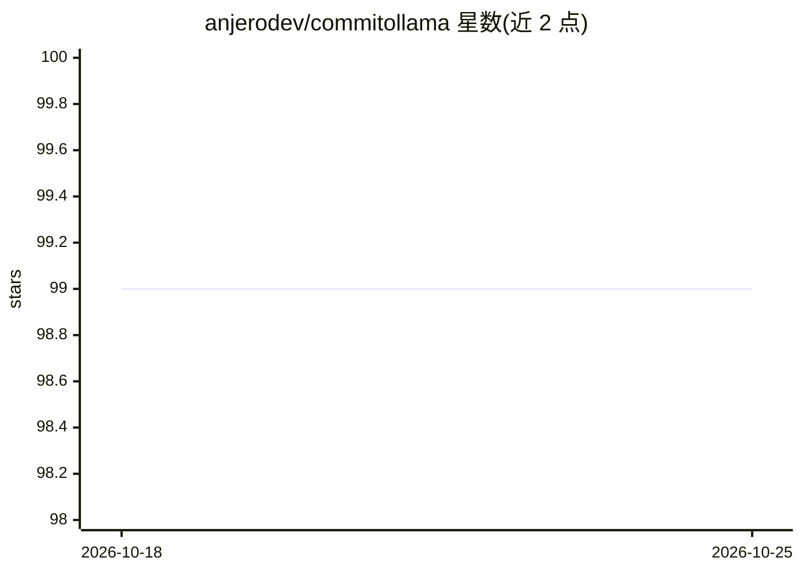

# anjerodev/commitollama

⭐ 99 · TypeScript · MIT · 推送 2026-10-20 · [GitHub](https://github.com/anjerodev/commitollama) · [官网](https://marketplace.visualstudio.com/items?itemName=commitollama.commitollama) · 个人维护

**VS Code 扩展：用本地 Ollama 模型生成 Git 提交信息**

面向 Git 用户的 VS Code 扩展，基于本地 Ollama（或 OpenAI 兼容服务器如 LM Studio）读取暂存区变更生成提交信息，写入提交输入框，自称 GitHub Copilot 提交生成功能的免费本地替代。支持模型快速切换、emoji 与多语言提交格式自定义、自定义提示词与提交类型规则，以及后台预生成文件摘要以加速提交。无需 API key 与联网、无遥测。限制：部分模型不支持其所需的结构化 JSON 输出，建议使用小型非推理模型。

## 筛选速览

| 维度 | 判定 | 备注 |
|---|---|---|
| AI 角色 | `ai-native` | 本体是模型或模型工具 |
| 许可风险 | `permissive` | MIT |
| 部署形态 | `None` |  |
| 模型依赖 | local-ok | 支持本地模型 |
| 硬件要求 | — | 无带数字的原话,不猜 |
| 安装摩擦 | `low` | 无编译、无系统依赖或容器化 |
| 成熟度 | — | 结构信号不足 |

## 能力要点

- 读取暂存区 diff 或文件摘要生成提交信息
- 支持 Ollama 与 OpenAI 兼容服务器（LM Studio 等）双后端
- 后台预生成变更摘要，提交时复用缓存加速
- emoji、语言、提示词与提交类型规则均可自定义

## 适用场景

- 在 VS Code 中一键生成 Git 提交信息
- 离线、无 API key 环境下用本地模型写 commit
- 按团队规范自定义提交格式与语言

## 场景标签

`AI 写作` · 领域:内容生成

## 证据(README 行号)

> L3: A free alternative to Github Copilot's commit generator that runs on your device using [Ollama][1].
> L20: - Install [Ollama][1] on your local machine.
> L39: 2. Run **Commitollama** from the Source Control title bar (sparkle icon).

## 星数曲线

2026-10-18 99 → 2026-10-25 99（+0）

---
*卡片 v1 · prompt 1.4 · 生成 2026-10-23 · 置信度 high · 依据 README sha `5209084d3d7a` · [字段定义](../../DATASET.md)*
