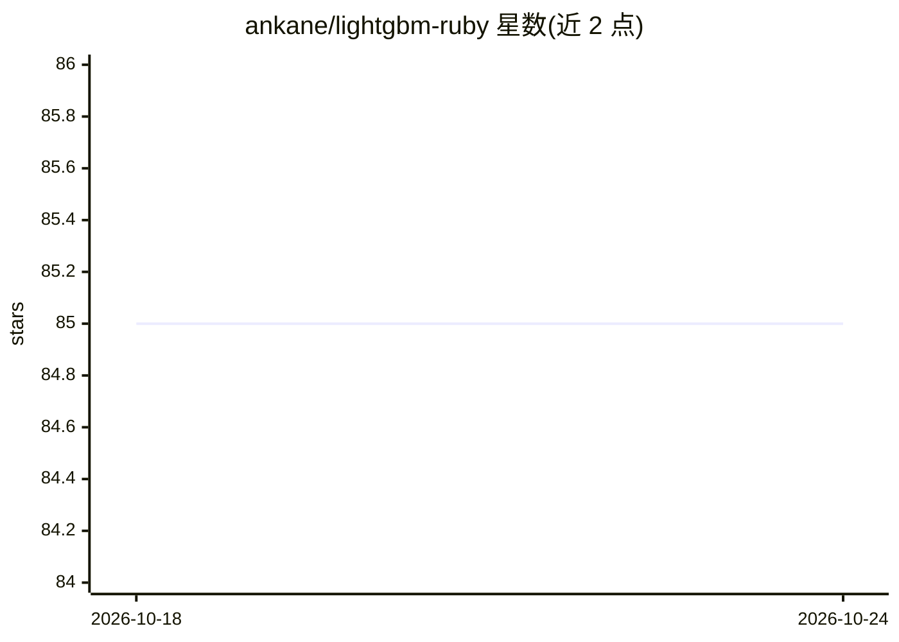

# ankane/lightgbm-ruby

⭐ 85 · Ruby · MIT · 推送 2026-07-18 · [GitHub](https://github.com/ankane/lightgbm-ruby) · 个人维护

**Ruby 版 LightGBM 绑定：训练与预测梯度提升模型**

通过 FFI 在 Ruby 中调用 LightGBM 梯度提升库的 gem，提供 Training API（LightGBM.train、Dataset、Booster）与仿 scikit-learn 的 Regressor/Classifier 接口，支持训练、预测、模型保存/加载、特征重要度、early stopping 与交叉验证。数据可接受数组、Numo 数组或 Rover 数据框。API 遵循 Python 版并有少量差异（去掉 get_/set_ 前缀、默认 verbosity 为 -1、cv 默认非分层）。Mac 上需另装 OpenMP（brew install libomp）。面向 Ruby 开发者与机器学习使用者。

## 筛选速览

| 维度 | 判定 | 备注 |
|---|---|---|
| AI 角色 | `ai-native` | 本体是模型或模型工具 |
| 许可风险 | `permissive` | MIT |
| 部署形态 | `None` |  |
| 模型依赖 | — | README 未给出锁定关系 |
| 硬件要求 | — | 无带数字的原话,不猜 |
| 安装摩擦 | `low` | 无编译、无系统依赖或容器化 |
| 成熟度 | — | 结构信号不足 |

## 能力要点

- Training API 与 scikit-learn 风格两套接口（Regressor/Classifier）
- 支持模型保存/加载、特征重要度、early stopping、CV
- 数据输入支持数组、Numo::NArray 与 Rover 数据框
- 通过 FFI 调用 LightGBM，API 遵循 Python 版本

## 适用场景

- 在 Ruby 应用中训练梯度提升回归/分类模型
- 加载已有 LightGBM 模型文件进行预测
- 查看特征重要度与做交叉验证

## 场景标签

 · 领域:机器学习/开发库

## 证据(README 行号)

> L3: LightGBM - high performance gradient boosting - for Ruby
> L35: booster = LightGBM.train(params, train_set)
> L86: model = LightGBM::Regressor.new

## 星数曲线

2026-10-18 85 → 2026-10-24 85（+0）

---
*卡片 v1 · prompt 1.4 · 生成 2026-10-24 · 置信度 high · 依据 README sha `49bd6126030b` · [字段定义](../../DATASET.md)*
