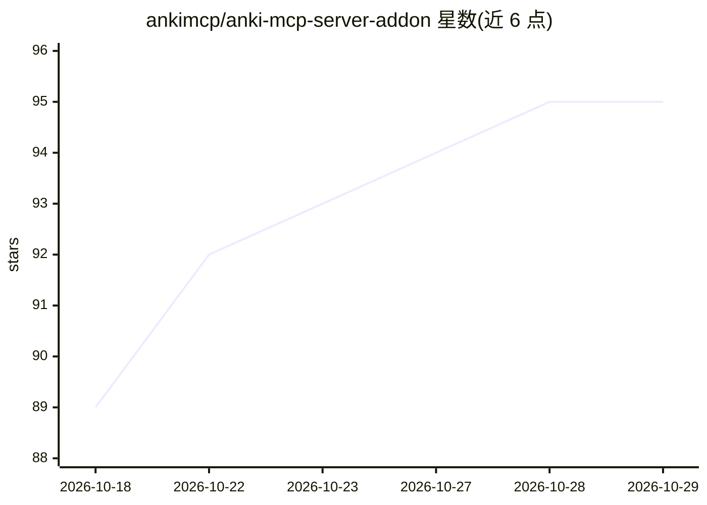

# ankimcp/anki-mcp-server-addon

⭐ 95 · Python · NOASSERTION · 推送 2026-10-11 · [GitHub](https://github.com/ankimcp/anki-mcp-server-addon) · [官网](https://ankimcp.ai) · 组织维护

**Anki 插件：在 Anki 内运行 MCP 服务器，让 AI 助手操作卡组**

一个 Anki 插件，在 Anki 进程内启动本地 MCP 服务器（默认 http://127.0.0.1:3141/），使 Claude Desktop、Claude Code、Opencode 等 MCP 客户端能够读写用户的闪卡集合：创建卡片、管理字段/标签/牌组、触发同步、批量读取调度统计等。供使用 Anki 且希望通过 AI 助手辅助学习的用户。内置 WebSocket 隧道可生成公开 HTTPS URL（需 ankimcp.ai 账号，OAuth 2.0 设备流程登录），亦支持 Cloudflare Tunnel/ngrok。安全机制：DNS 重绑定防护、可选 Bearer API key、破坏性工具默认对客户端隐藏需白名单启用。跨平台，经 AnkiWeb 代码、GitHub Release 的 .ankiaddon 文件或 NixOS flake 安装。

## 筛选速览

| 维度 | 判定 | 备注 |
|---|---|---|
| AI 角色 | `ai-ecosystem` | LLM/agent 周边工具 |
| 许可风险 | `none` | NOASSERTION |
| 部署形态 | `library` | 以包/库形式分发 |
| 模型依赖 | — | README 未给出锁定关系 |
| 硬件要求 | — | 无带数字的原话,不猜 |
| 安装摩擦 | `low` | 无编译、无系统依赖或容器化 |
| 成熟度 | — | 结构信号不足 |

## 能力要点

- 在 Anki 内运行本地 MCP 服务器，默认 127.0.0.1:3141
- 内置隧道提供公开 HTTPS URL，支持远程 AI 客户端访问
- 破坏性工具默认隐藏，需 enabled_destructive_tools 白名单服务端放行
- 工具声明 readOnlyHint/destructiveHint 等 MCP 注解供客户端确认

## 适用场景

- 让 Claude 等 AI 助手直接读写我的 Anki 卡组
- 让 AI 根据学习材料批量创建闪卡
- 通过公网隧道在异地用 AI 客户端访问本地 Anki 集合

## 场景标签

 · 领域:学习工具/AI 接入

## 证据(README 行号)

> L7: An Anki addon that exposes your collection to AI assistants via the Model Context Protocol (MCP).
> L11: AnkiMCP Server runs a local MCP server inside Anki, allowing AI assistants like Claude to interact with your flashc

## 星数曲线

2026-10-18 89 → 2026-10-29 95（+6）

---
*卡片 v1 · prompt 1.4 · 生成 2026-10-24 · 置信度 mid · 依据 README sha `2fbdcc885ee6` · [字段定义](../../DATASET.md)*
