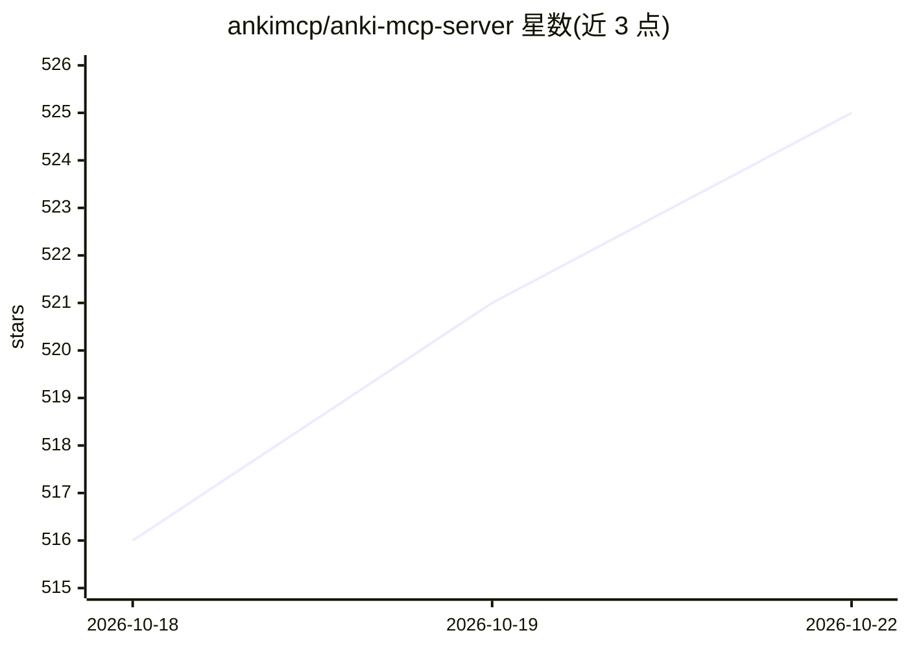

# ankimcp/anki-mcp-server

⭐ 525 · TypeScript · MIT · 推送 2026-10-11 · [GitHub](https://github.com/ankimcp/anki-mcp-server) · [官网](https://ankimcp.ai) · 组织维护

**让 AI 助手通过 MCP 操作 Anki 记忆卡片的服务器**

一个 Model Context Protocol (MCP) 服务器，使 Claude Desktop、Cursor 等 AI 客户端能够与间隔重复记忆卡片应用 Anki 交互。通过 53 个 MCP 工具覆盖复习（同步 AnkiWeb、取到期卡、评分）、牌组/笔记/标签/媒体/模板管理与统计，另含 11 个驱动 Anki 桌面界面的 GUI 工具。依赖已安装 AnkiConnect 插件的 Anki 与 Node.js 22.12.0+，经 AnkiConnect 通信。支持 STDIO 与 HTTP 传输及远程隧道；README 提示多数场景建议改用 AnkiMCP 插件，本仓库面向 STDIO/MCPB 场景，仍在维护。

## 筛选速览

| 维度 | 判定 | 备注 |
|---|---|---|
| AI 角色 | `ai-ecosystem` | LLM/agent 周边工具 |
| 许可风险 | `permissive` | MIT |
| 部署形态 | `desktop` | 安装包/桌面程序 |
| 模型依赖 | — | README 未给出锁定关系 |
| 硬件要求 | — | 无带数字的原话,不猜 |
| 安装摩擦 | `low` | 无编译、无系统依赖或容器化 |
| 成熟度 | — | 结构信号不足 |

## 能力要点

- 53 个 MCP 工具：复习、牌组/笔记/标签/媒体/模板管理与统计
- 11 个 GUI 工具驱动 Anki 桌面界面（卡片浏览器、笔记编辑器等）
- npm/npx 安装，另提供 Claude Desktop 一键安装的 .mcpb 包
- 支持本地 STDIO/HTTP 与远程隧道/ngrok 两种接入方式

## 适用场景

- 用自然语言让 AI 助手带我复习 Anki 卡片并讲解概念
- 让 AI 批量创建、编辑笔记（如带 RTL 样式的阿拉伯语词汇卡）
- 通过对话管理牌组、标签、媒体文件与复习统计

## 场景标签

`知识库管理` · 领域:知识与检索

## 证据(README 行号)

> L24: A Model Context Protocol (MCP) server that enables AI assistants to interact with Anki, the spaced repetition flash
> L46: ## Available Tools

## 星数曲线

2026-10-18 516 → 2026-10-22 525（+9）

---
*卡片 v1 · prompt 1.4 · 生成 2026-10-21 · 置信度 high · 依据 README sha `8aa8b67d750f` · [字段定义](../../DATASET.md)*
