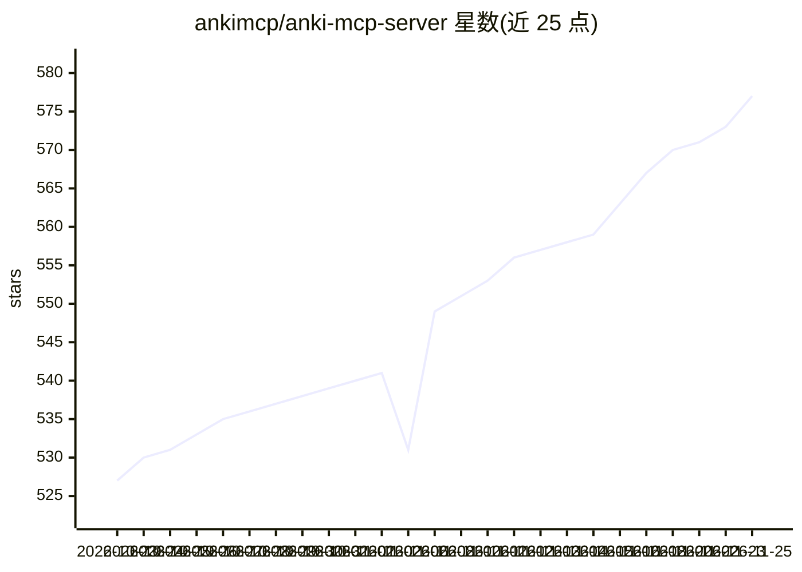

# ankimcp/anki-mcp-server

⭐ 577 · TypeScript · MIT · 推送 2026-11-07 · [GitHub](https://github.com/ankimcp/anki-mcp-server) · [官网](https://ankimcp.ai) · 组织维护

**让 AI 助手通过 MCP 操作 Anki 间隔重复卡片的连接服务器**

实现 Model Context Protocol 的服务器，把 Anki 的复习、牌组、笔记、标签、媒体、模板与统计能力封装为 53 个 MCP 工具，供 Claude Desktop、Cursor、ChatGPT 等 AI 客户端调用；支持 STDIO、HTTP 与隧道三种传输方式，本地与远程接入均可。运行前提为已装 AnkiConnect 插件的 Anki 与 Node.js 22.12.0+；提供 npm、.mcpb 包与源码三种安装途径，另推荐功能更全的 AnkiMCP 插件方案。

## 筛选速览

| 维度 | 判定 | 备注 |
|---|---|---|
| AI 角色 | `ai-ecosystem` | LLM/agent 周边工具 |
| 许可风险 | `permissive` | MIT |
| 部署形态 | `desktop` | 安装包/桌面程序 |
| 模型依赖 | — | README 未给出锁定关系 |
| 硬件要求 | — | 无带数字的原话,不猜 |
| 安装摩擦 | `low` | 无编译、无系统依赖或容器化 |
| 成熟度 | — | 结构信号不足 |

## 能力要点

- 暴露 53 个 MCP 工具（42 常用 + 11 GUI 工具），覆盖复习、笔记、标签、媒体、模板与统计
- 支持 STDIO/HTTP/隧道三种传输，适配本地桌面客户端与云端 AI
- 提供 .mcpb 一键安装包与 npm 全局安装
- 支持 AnkiWeb 同步、批量建卡与 RTL 自定义模板创建

## 适用场景

- 让 AI 助手带讲解地陪我复习西班牙语牌组
- 让 AI 按要求批量生成带 RTL 样式的阿拉伯语词汇卡
- 从本地文件夹把图片自动上传为卡片正面的媒体文件

## 场景标签

 · 领域:教育/学习工具

## 证据(README 行号)

> L24: A Model Context Protocol (MCP) server that enables AI assistants to interact with Anki, the spaced repetition flash
> L48: The server exposes **53 MCP tools** — 42 essential tools for everyday Anki operations and 11 GUI tools that drive t
> L137: ## Prerequisites

## 星数曲线

2026-10-23 527 → 2026-11-25 577（+50）

---
*卡片 v1 · prompt 1.4 · 生成 2026-11-25 · 置信度 high · 依据 README sha `c6253f72a2d6` · [字段定义](../../DATASET.md)*
