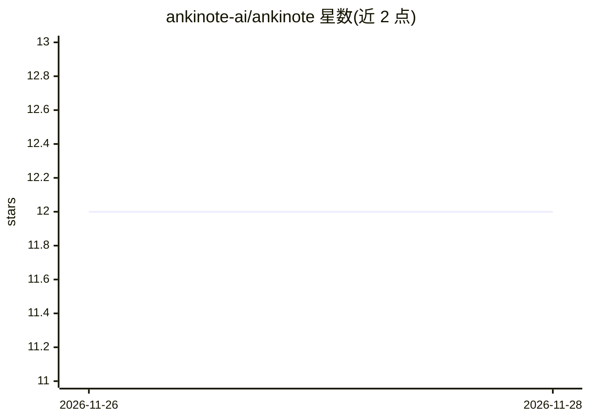

# ankinote-ai/ankinote

⭐ 12 · Python · MIT · 推送 2026-11-26 · [GitHub](https://github.com/ankinote-ai/ankinote) · 组织维护 · 中文 README

**为 Anki 用户用 AI 自动生成单词/句子/理科题卡片**

AnkiNote 是一个 AI 驱动的 Anki 卡片制作工具：输入单词、短语、句子或理科题目（可拍照），生成含释义、例句、记忆钩子、插画与 TTS 音频的成品卡片并直接存入 Anki。通过 AnkiConnect 接入 Anki Desktop，或在内置 Anki + AnkiWeb 同步的无头服务器/NAS 上运行。提供 Web 界面、CLI 与 Agent 技能三种使用方式，支持 4 种卡片模式、多语言学习与多主题样式。需自带 API key，密钥保存在本地配置文件。

## 筛选速览

| 维度 | 判定 | 备注 |
|---|---|---|
| AI 角色 | `ai-native` | 本体是模型或模型工具 |
| 许可风险 | `permissive` | MIT |
| 部署形态 | `self-host` | docker 或自建部署 |
| 模型依赖 | — | README 未给出锁定关系 |
| 硬件要求 | — | 无带数字的原话,不猜 |
| 安装摩擦 | `low` | 无编译、无系统依赖或容器化 |
| 成熟度 | — | 结构信号不足 |

## 能力要点

- 单词/短语/句子/STEM 四种卡片模式，支持拍照输入题目生成解题卡
- 通过 AnkiConnect 写入 Anki Desktop，或 Docker 自托管内置 Anki + AnkiWeb 同步
- 支持 8 种语言学习（含中文拼音/ruby），任意语言解释任意语言
- 提供 CLI 与 Agent 技能（ankinote skill install），可由 Claude Code/Codex 等调用

## 适用场景

- 阅读外语文章时把生词批量做成 Anki 卡片复习
- 把做错的理科题目拍照生成带分步解答的复习卡
- 在家庭服务器/NAS 上自托管，用手机随时造卡

## 场景标签

 · 领域:教育/学习工具

## 证据(README 行号)

> L16: Making great Anki cards shouldn't take longer than reviewing them. **AnkiNote** is an AI-powered Anki card studio t
> L22: - **Works with Your Existing Anki** — Sends cards straight into Anki Desktop via AnkiConnect with no duplicate coll
> L54: 1. **AI Provider** — Paste a Gemini API key (covers text, image, and speech) or expand **Advanced** for OpenAI, Cla

## 星数曲线

2026-11-26 12 → 2026-11-28 12（+0）

---
*卡片 v1 · prompt 1.4 · 生成 2026-11-26 · 置信度 high · 依据 README sha `b59650aa8aee` · [字段定义](../../DATASET.md)*
