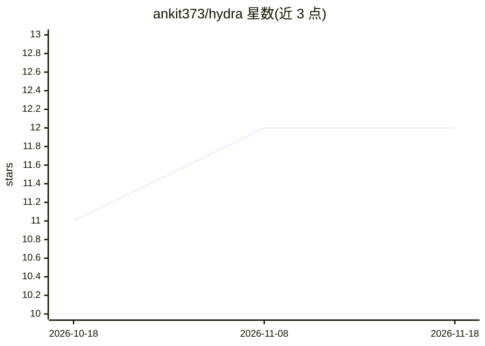

# ankit373/hydra

⭐ 12 · Go · MIT · 推送 2026-11-16 · [GitHub](https://github.com/ankit373/hydra) · [官网](https://hydra.uvansa.com/) · 个人维护

**面向开发者的 LLM 路由控制平面：按能力与成本分发并校验回答**

用 Go 编写的 CLI/桌面工具，发现本机已有的托管 API、本地模型服务与 CLI agent，按任务类型（writing/summary/extraction/classification/translation/answer/analysis/agent/code）的历史通过率路由到最低成本的可用模型，并维护回退链。提供 `--check` 校验器（schema、标签集、grounded 校对、任意命令）、`--confidence` 置信升级、成本与预算记录、PII/本地隐私策略，以及 OpenAI 兼容的 loopback 端点（hyctl serve）。通过 brew/npm/pip/安装脚本分发预编译二进制，另有桌面应用。

## 筛选速览

| 维度 | 判定 | 备注 |
|---|---|---|
| AI 角色 | `ai-ecosystem` | LLM/agent 周边工具 |
| 许可风险 | `permissive` | MIT |
| 部署形态 | `desktop` | 安装包/桌面程序 |
| 模型依赖 | local-ok | 支持本地模型 |
| 硬件要求 | — | 无带数字的原话,不猜 |
| 安装摩擦 | `low` | 无编译、无系统依赖或容器化 |
| 成熟度 | — | 结构信号不足 |

## 能力要点

- 自动发现本机模型（API key、本地服务、CLI agent），按实测通过率路由
- 内置多种回答校验机制：JSON Schema、标签匹配、ground 校对、模型一致
- 记录每次请求的模型、token 与估算成本，预算调节器随用量降档
- PII 策略与本地模式：敏感文件与含个人数据的 prompt 只发给本地模型

## 适用场景

- 让简单任务走低成本模型、失败时自动升级到更强模型
- 工单分类和发票字段抽取等输出需要校验的流水线
- 统一管理多个模型供应商的支出与预算
- 只允许本地模型处理含个人数据的 prompt

## 场景标签

`模型网关` `推理引擎` `LLM 可观测性` · 领域:Agent 开发

## 证据(README 行号)

> L27: You probably have several models to hand: hosted APIs (OpenAI, Anthropic, Gemini, Bedrock, Mistral and others), loc
> L152: **Routing.** Hydra finds your models in about two seconds and sends each request to the lowest-cost one measured g
> L160: **Serve.** `hyctl serve` puts the router behind an OpenAI-compatible endpoint on loopback, so any tool that speaks

## 星数曲线

2026-10-18 11 → 2026-11-18 12（+1）

---
*卡片 v1 · prompt 1.4 · 生成 2026-11-18 · 置信度 high · 依据 README sha `705da13350df` · [字段定义](../../DATASET.md)*
