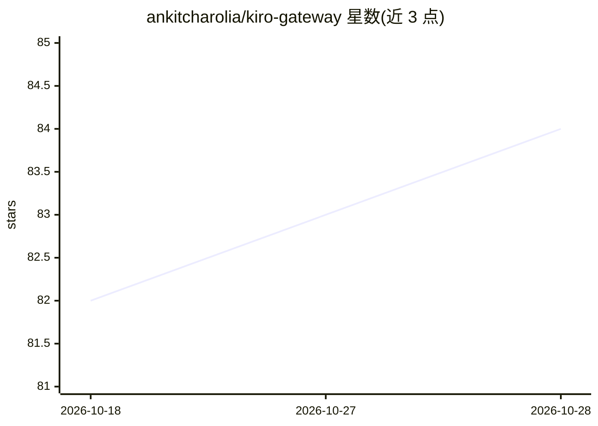

# ankitcharolia/kiro-gateway

⭐ 84 · Python · AGPL-3.0 · 推送 2026-10-28 · [GitHub](https://github.com/ankitcharolia/kiro-gateway) · [官网](https://github.com/ankitcharolia/kiro-gateway#quick-start) · 个人维护

**把 Kiro 订阅转成 OpenAI/Anthropic/ACP 接口的本地 AI 网关**

面向已订阅 Kiro 的开发者，通过官方 kiro-cli 二进制以 Agent Client Protocol 通信，把 OpenAI、Anthropic 与原生 ACP 客户端接入本地 http://localhost:8000，使 Claude Code、Cursor、OpenCode、Kilo Code 等工具复用 Kiro 订阅。关键机制：仅走官方集成面，不调用私有端点、不池化账号、不存凭证；启动时校验单账号，并行账号抛 ComplianceError；自动读取各 harness 的 MCP 配置并在 session/new 上注册，由 kiro-cli 自行执行工具。限制：不提供 embeddings（返回 501），模型目录随 Kiro 轮换。

## 筛选速览

| 维度 | 判定 | 备注 |
|---|---|---|
| AI 角色 | `ai-ecosystem` | LLM/agent 周边工具 |
| 许可风险 | `viral` | AGPL-3.0 |
| 部署形态 | `library` | 以包/库形式分发 |
| 模型依赖 | — | README 未给出锁定关系 |
| 硬件要求 | — | 无带数字的原话,不猜 |
| 安装摩擦 | `low` | 无编译、无系统依赖或容器化 |
| 成熟度 | — | 结构信号不足 |

## 能力要点

- OpenAI/Anthropic/ACP 三种 shim 共用一个本地网关端口
- 仅经官方 kiro-cli 通信，单账号合规校验（ComplianceError）
- 自动发现并转发 harness 已注册的 MCP 服务器（stdio 与远程形式）
- SSE keepalive 心跳应对 kiro-cli 工具执行期间的长时间静默

## 适用场景

- 在 Claude Code、Cursor、OpenCode 等工具中复用已有的 Kiro 订阅
- 把只支持 OpenAI 或 Anthropic API 的客户端接到 Kiro 后端
- 让已配置的 MCP 服务器经由网关在 Kiro 会话中继续可用

## 场景标签

`模型网关` · 领域:Agent 开发

## 证据(README 行号)

> L12: Use your Kiro subscription from **Claude Code, OpenCode, Cursor, Kilo Code**, and other OpenAI- or Anthropic-compat
> L15: - **One local gateway:** OpenAI, Anthropic, and native ACP clients can share `http://localhost:8000`.

## 星数曲线

2026-10-18 82 → 2026-10-28 84（+2）

---
*卡片 v1 · prompt 1.4 · 生成 2026-10-24 · 置信度 mid · 依据 README sha `faaaf83885ed` · [字段定义](../../DATASET.md)*
