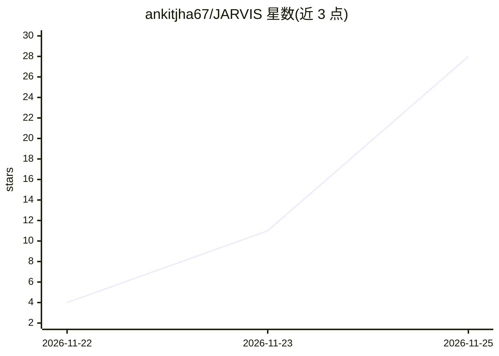

# ankitjha67/JARVIS

⭐ 28 · Python · 推送 2026-11-22 · [GitHub](https://github.com/ankitjha67/JARVIS) · 个人维护

**Windows 个人 AI 桌面助手：语音控制 + 164 工具操作电脑**

运行在 Windows 本机的全栈个人 AI 助手：将请求路由到本地或云端 LLM，通过 164 个工具执行桌面/文件/浏览器/邮件/智能家居等操作，并以 React 构建的 HUD 展示。安全机制包括四级风险分层（T0-T3）、不可信内容污染追踪、执行后结果校验、可撤销操作栈与一键终止快捷键。快速路径模式匹配让简单指令不经 LLM 直接执行；首次安装有 6 步引导向导，助手名称与唤醒词可自定义。

## 筛选速览

| 维度 | 判定 | 备注 |
|---|---|---|
| AI 角色 | `ai-native` | 本体是模型或模型工具 |
| 许可风险 | `none` | — |
| 部署形态 | `library` | 以包/库形式分发 |
| 模型依赖 | local-ok | 支持本地模型 |
| 硬件要求 | — | 无带数字的原话,不猜 |
| 安装摩擦 | `low` | 无编译、无系统依赖或容器化 |
| 成熟度 | — | 结构信号不足 |

## 能力要点

- 164 个工具覆盖桌面控制、文件、浏览器、邮件、智能家居等 46 个模块
- 8 个 LLM 提供商接入，支持本地（LM Studio/Ollama）与云端，含隐私模式
- 工具按 T0-T3 风险分级，修改类操作需用户批准，附审计日志与撤销栈
- 简单指令经 fast-path 模式匹配直接执行，不调用 LLM

## 适用场景

- 用语音或键盘让助手代为操作 Windows 应用、文件与浏览器
- 本地 LLM 隐私模式下在个人电脑上运行 AI 助手
- 让助手批量处理文档格式转换、邮件读取与定时任务
- 通过 Android 伴侣应用远程向桌面助手发送指令

## 场景标签

`AI 助手` `GUI 自动化` · 领域:效率与自动化

## 证据(README 行号)

> L5:  Personal AI Desktop Assistant for Windows
> L14: JARVIS is a full-stack personal AI assistant that runs entirely on your Windows machine. It routes requests to loca
> L35: - **8 LLM providers** out of the box: LM Studio, Ollama, NVIDIA NIM, Anthropic, OpenAI, Google Gemini, OpenRouter, 

## 星数曲线

2026-11-22 4 → 2026-11-25 28（+24）

---
*卡片 v1 · prompt 1.4 · 生成 2026-11-22 · 置信度 mid · 依据 README sha `4de14c6a5906` · [字段定义](../../DATASET.md)*
