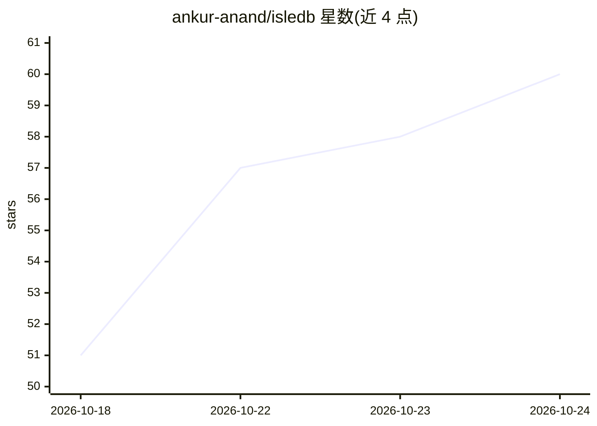

# ankur-anand/isledb

⭐ 60 · Go · Apache-2.0 · 推送 2026-10-23 · [GitHub](https://github.com/ankur-anand/isledb) · [官网](https://isledb.com) · 个人维护

**基于对象存储的 Go 键值数据库，供多语言服务读写**

用 Go 编写的嵌入式/服务化键值数据库，将 S3、Google Cloud Storage、Azure Blob 或任意 S3 兼容存储（如 MinIO）作为持久层；本地文件与内存仅限开发。架构为一个围栏写者加任意数量独立读进程，写者可经 HTTP 服务暴露给任意语言；提供点读、范围扫描、快照、TTL、变更流、独立 compaction 与可选区域共享读缓存。限制：读新鲜度为秒级，不支持多键事务、二级索引与查询语言；1.0 前 API 可能随次版本变化。

## 筛选速览

| 维度 | 判定 | 备注 |
|---|---|---|
| AI 角色 | `ai-enhanced` | 去掉 AI 部分产品仍成立 |
| 许可风险 | `permissive` | Apache-2.0 |
| 部署形态 | `self-host` | docker 或自建部署 |
| 模型依赖 | — | README 未给出锁定关系 |
| 硬件要求 | — | 无带数字的原话,不猜 |
| 安装摩擦 | `low` | 无编译、无系统依赖或容器化 |
| 成熟度 | `idea` | |

## 能力要点

- 对象存储作为持久层，读进程可独立扩展无需维护副本
- isledb writer 经 HTTP 向任意语言提供写入通道
- keys-only 或全值变更流供下游消费
- compaction/maintenance 可独立进程或定时任务运行

## 适用场景

- 把云对象存储当数据库用，省去自建存储服务器
- 读多写少、可批量发布写入的数据服务
- 跨语言服务通过 HTTP 读写共享键值数据

## 场景标签

 · 领域:数据库/存储基础设施

## 证据(README 行号)

> L10: **A key-value database for object storage, written in Go.**

## 星数曲线

2026-10-18 51 → 2026-10-24 60（+9）

---
*卡片 v1 · prompt 1.4 · 生成 2026-10-24 · 置信度 low · 依据 README sha `f9e1327fb583` · [字段定义](../../DATASET.md)*
