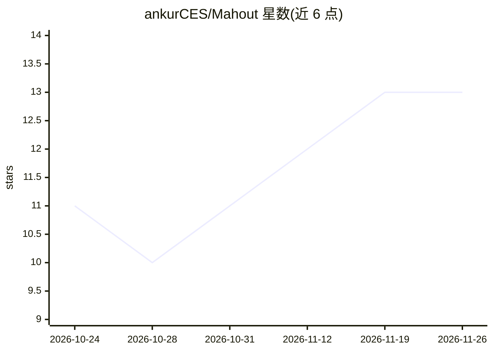

# ankurCES/Mahout

⭐ 13 · Kotlin · 推送 2026-09-27 · [GitHub](https://github.com/ankurCES/Mahout) · 个人维护

**Android 本地工作流自动化应用，节点化编排设备能力**

面向 Android 的全离线工作流自动化应用，自称 Tasker 的 FOSS 替代。设备能力以约 90+ 节点呈现，分九个 lane（触发器、数据、逻辑、AI、动作等），用户在可拖拽 DAG 画布上连线编排，可手动、定时或由通知/位置/传感器等触发运行。AI 部分包括用自然语言描述生成工作流的 Build with AI、管理工作流的 Chat Operator（四种权限模式）、端上 RAG 知识库（Room FTS4/BM25）与 MCP 服务器接入。AI 经 Gemini Nano 在设备上运行或使用用户自己的 API key。从源码构建，需 Android Studio、Java 17 等。

## 筛选速览

| 维度 | 判定 | 备注 |
|---|---|---|
| AI 角色 | `ai-enhanced` | 去掉 AI 部分产品仍成立 |
| 许可风险 | `none` | — |
| 部署形态 | `None` |  |
| 模型依赖 | local-ok | 支持本地模型 |
| 硬件要求 | — | 无带数字的原话,不猜 |
| 安装摩擦 | `medium` | 含编译或系统依赖之一 |
| 成熟度 | — | 结构信号不足 |

## 能力要点

- ~90+ 设备能力节点，九个 lane 组织，可视化 DAG 编辑器
- Chat Operator 助手含 Plan/Ask/Auto/Bypass 四种权限模式，逐 token 流式输出
- 端上 RAG 知识库：索引文档/URL/文本，BM25 排序
- 支持远程 MCP 服务器（stdio/SSE），其工具可暴露给 Agent 或作为工作流节点

## 适用场景

- 用通知、位置、传感器等触发器编排手机自动化流程
- 用自然语言描述让 AI 起草自动化工作流
- 把本地文档建成端上知识库供 Agent 检索
- 接入 MCP 服务器把远程工具纳入自动化流程

## 场景标签

`工作流自动化` `RAG` · 领域:效率与自动化

## 证据(README 行号)

> L5:  Mahout is a fully open-source, on-device, FOSS alternative to Tasker for Android.
> L54: |**AI**|Ask AI, Classify, Extract, Agent (tool-using loop), MCP tool/resource, Decision routing|
> L87: 11 OpenAI-compatible providers (OpenAI, OpenRouter, MiniMax, Gemini, Grok, DeepSeek, Mistral, Groq, Together, Ollam

## 星数曲线

2026-10-24 11 → 2026-11-26 13（+2）

---
*卡片 v1 · prompt 1.4 · 生成 2026-11-18 · 置信度 high · 依据 README sha `a2756a5f9856` · [字段定义](../../DATASET.md)*
