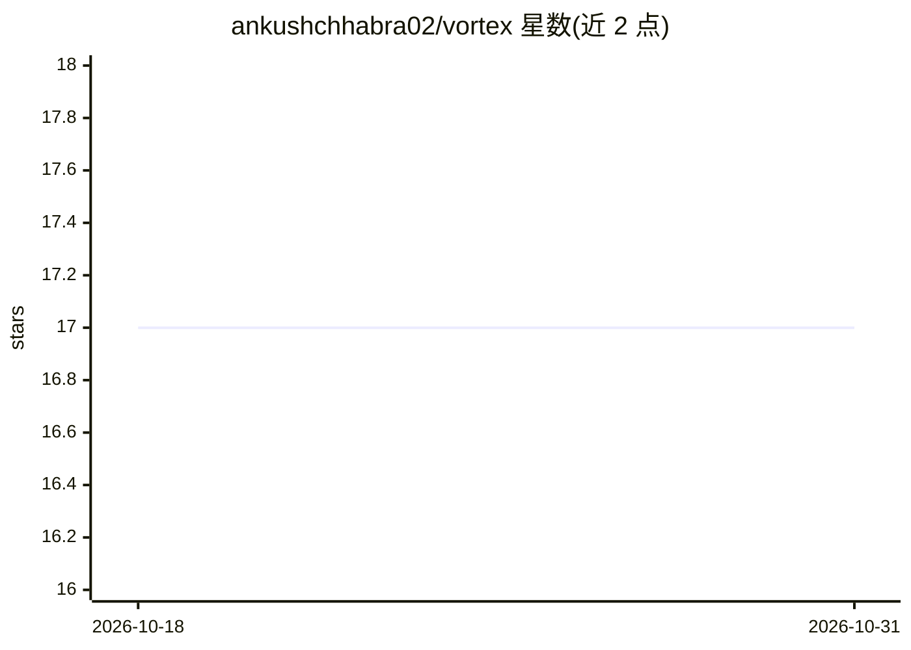

# ankushchhabra02/vortex

⭐ 17 · TypeScript · MIT · 推送 2026-09-03 · [GitHub](https://github.com/ankushchhabra02/vortex) · [官网](https://vortex-rho-cyan.vercel.app) · 个人维护

**自托管 RAG 文档问答应用：用多种 LLM 与私有文档对话**

基于 Next.js + Supabase（pgvector）的自托管 RAG 应用：上传 PDF/文本或抓取 URL，文档被切分为带重叠的语义块并嵌入 pgvector；检索采用向量相似度与 BM25 关键词混合（RRF 融合）再加精排，回答带 [n] 引用标注回链来源。支持 5 个 LLM 提供方与 4 种嵌入提供方（含本地 Transformers.js 免费嵌入），API 密钥 AES-256-GCM 加密存储。面向想在自己基础设施上搭建知识库问答的个人或团队，需 Node.js 18+ 与 Supabase 项目，未提及本地推理运行时（如 Ollama）。

## 筛选速览

| 维度 | 判定 | 备注 |
|---|---|---|
| AI 角色 | `ai-native` | 本体是模型或模型工具 |
| 许可风险 | `permissive` | MIT |
| 部署形态 | `None` |  |
| 模型依赖 | locked-api |  |
| 硬件要求 | — | 无带数字的原话,不猜 |
| 安装摩擦 | `low` | 无编译、无系统依赖或容器化 |
| 成熟度 | — | 结构信号不足 |

## 能力要点

- 混合检索：pgvector 余弦相似度 + BM25，RRF 融合 + 精排
- 回答含 [n] 引用标注并链接回具体文档来源
- 5 个 LLM 提供方 + 4 个嵌入提供方（含本地免费嵌入，无 API key 可启动）
- 行级安全策略、SSRF 防护、API 密钥加密等安全机制

## 适用场景

- 把个人或团队的 PDF、网页文档建成可对话的知识库
- 私有部署一套带来源引用的文档问答系统
- 无需付费 API key 即可用免费模型快速体验 RAG

## 场景标签

`文档问答` `知识库管理` · 领域:知识与检索

## 证据(README 行号)

> L16: Vortex is a self-hosted RAG (Retrieval-Augmented Generation) application that lets you chat with your documents usi
> L29: - **5 LLM Providers** — OpenAI, Anthropic, Google, xAI (Grok), and OpenRouter. Switch providers and models from the

## 星数曲线

2026-10-18 17 → 2026-10-31 17（+0）

---
*卡片 v1 · prompt 1.4 · 生成 2026-10-29 · 置信度 high · 依据 README sha `b4ad9509c643` · [字段定义](../../DATASET.md)*
