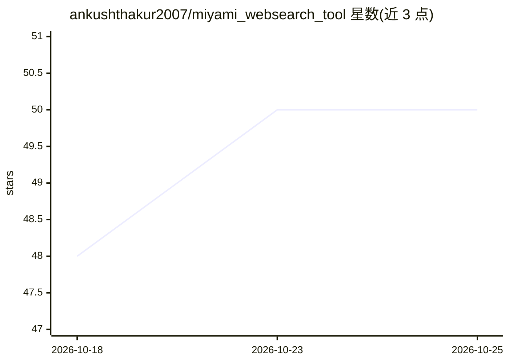

# ankushthakur2007/miyami_websearch_tool

⭐ 50 · Python · Apache-2.0 · 推送 2026-10-19 · [GitHub](https://github.com/ankushthakur2007/miyami_websearch_tool) · 个人维护

**面向 LLM 的 SearXNG 搜索与网页内容提取 FastAPI 封装**

以 FastAPI 封装 SearXNG，为 LLM/agent 提供 Web 搜索、网页正文提取（Trafilatura，输出 Markdown）、搜索后自动抓取、多查询并行深度研究、Scrapy 递归爬站、YouTube 字幕获取等 8 个 HTTP 端点。支持时间范围过滤、FlashRank 语义重排、DiskCache 缓存、四级反爬隐身模式与自动升级绕过。可输出 MCP 工具定义供 AI agent 调用。提供 Docker 与源码两种运行方式；/yt-transcript 端点目前仅限 localhost 使用。

## 筛选速览

| 维度 | 判定 | 备注 |
|---|---|---|
| AI 角色 | `ai-ecosystem` | LLM/agent 周边工具 |
| 许可风险 | `permissive` | Apache-2.0 |
| 部署形态 | `self-host` | docker 或自建部署 |
| 模型依赖 | — | README 未给出锁定关系 |
| 硬件要求 | — | 无带数字的原话,不猜 |
| 安装摩擦 | `low` | 无编译、无系统依赖或容器化 |
| 成熟度 | — | 结构信号不足 |

## 能力要点

- 搜索/抓取/深度研究/爬站/YouTube 字幕共 8 个端点
- Trafilatura 正文提取，输出 Markdown/JSON，自动处理 PDF/DOCX 等文档
- 无 API key 的四级隐身反爬模式与 auto_bypass 自动升级
- 提供 MCP 工具定义示例供 AI agent 调用

## 适用场景

- 为 LLM 或 agent 提供可调用的 Web 搜索与内容提取 API
- 多查询并行研究并生成汇总 Markdown 报告
- 批量爬取文档站点构建知识库素材

## 场景标签

`网页抓取` · 领域:效率与自动化

## 证据(README 行号)

> L3: A FastAPI wrapper for SearXNG that provides LLM-friendly search and web content extraction capabilities.
> L19: - **🤖 LLM Optimized**: Clean JSON/Markdown responses perfect for LLM consumption
> L331: ### MCP Tool Definitions

## 星数曲线

2026-10-18 48 → 2026-10-25 50（+2）

---
*卡片 v1 · prompt 1.4 · 生成 2026-10-24 · 置信度 mid · 依据 README sha `2b1eea13261c` · [字段定义](../../DATASET.md)*
