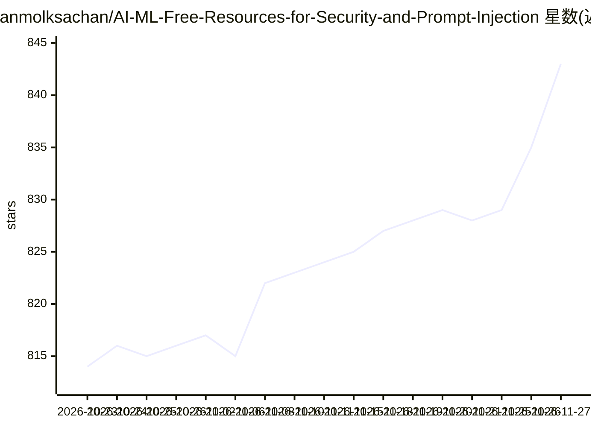

# anmolksachan/AI-ML-Free-Resources-for-Security-and-Prompt-Injection

⭐ 843 · 推送 2026-11-25 · [GitHub](https://github.com/anmolksachan/AI-ML-Free-Resources-for-Security-and-Prompt-Injection) · [官网](https://anmolksachan.github.io/LLMPenTestHub/ai-ml-roadmap-for-pentester.html) · 个人维护

**AI/ML 安全渗透测试入门学习路线图与资源合集**

面向从零到实践者的结构化学习指南，按 8 个阶段组织：前置基础、机器学习与 LLM 基础、AI/ML 安全概念、提示注入与 LLM 攻击、Agent/MCP/RAG 生态安全、动手实践、进阶利用与漏洞赏金。以清单形式收录课程、标准（OWASP LLM Top 10、MITRE ATLAS、NIST AI 100-2）、工具仓库、数据集、论文与社区资源，并对条目标注 Foundational/Historical/Archived 等状态。纯资源索引，无安装或运行环节。

## 筛选速览

| 维度 | 判定 | 备注 |
|---|---|---|
| AI 角色 | `ai-knowledge` | 知识聚合/清单类 |
| 许可风险 | `none` | — |
| 部署形态 | `None` |  |
| 模型依赖 | — | README 未给出锁定关系 |
| 硬件要求 | — | 无带数字的原话,不猜 |
| 安装摩擦 | `low` | 无编译、无系统依赖或容器化 |
| 成熟度 | — | 结构信号不足 |

## 能力要点

- 8 阶段学习路线覆盖从 Web 安全基础到 Agent/MCP/RAG 安全
- 汇总 OWASP、MITRE ATLAS、NIST 等标准与框架条目
- 条目带状态标注（Foundational/Historical/Archived/Unverified）
- 涵盖提示注入、工具投毒、向量泄露等攻击面分类

## 适用场景

- 为零基础转入 AI/ML 渗透测试规划学习路径
- 查找提示注入与 LLM 攻击的学习资料与实践靶场
- 检索 AI 安全领域的标准、论文与社区资源

## 场景标签

`网络安全` `精选清单` · 领域:学习与行业

## 证据(README 行号)

> L5: > A comprehensive, structured guide to learning AI/ML security and penetration testing — from zero to practitioner. 
> L13: 2. Phase 1 — Foundations

## 星数曲线

2026-10-23 814 → 2026-11-27 843（+29）

---
*卡片 v1 · prompt 1.4 · 生成 2026-11-26 · 置信度 mid · 依据 README sha `7cad4c86fbaf` · [字段定义](../../DATASET.md)*
