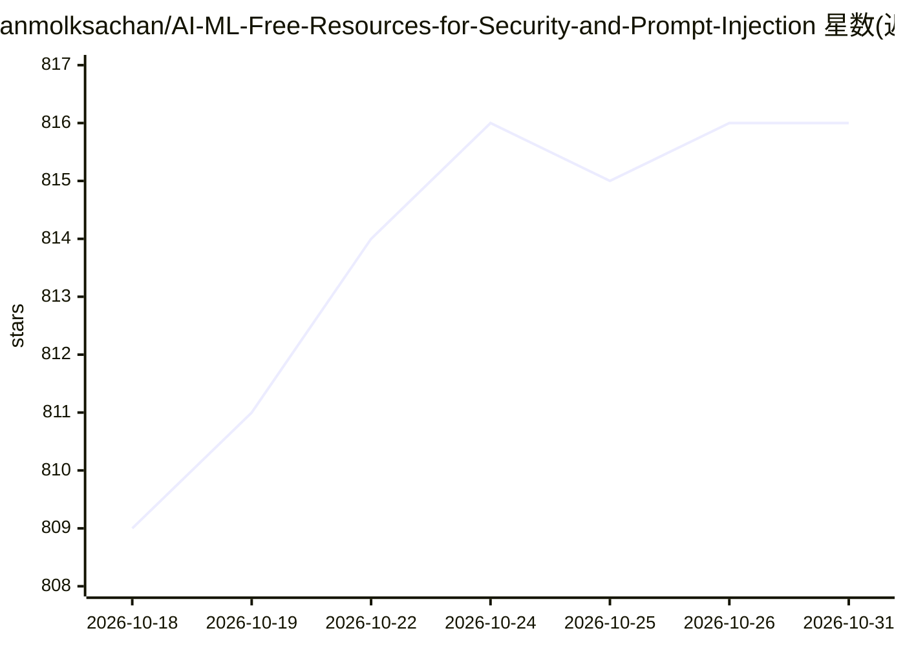

# anmolksachan/AI-ML-Free-Resources-for-Security-and-Prompt-Injection

⭐ 816 · 推送 2026-10-22 · [GitHub](https://github.com/anmolksachan/AI-ML-Free-Resources-for-Security-and-Prompt-Injection) · [官网](https://anmolksachan.github.io/LLMPenTestHub/ai-ml-roadmap-for-pentester.html) · 个人维护

**AI/ML 安全与渗透测试学习路线图与资源清单**

面向初学者到实践者的 AI/ML 安全学习路线图：以 8 个阶段组织内容，覆盖 ML/LLM 基础、AI 安全概念（OWASP LLM/MCP Top 10、MITRE ATLAS、NIST 分类）、提示注入与越狱攻击、Agentic AI/MCP 安全、RAG 与向量安全、动手实践与真实研究。条目以课程、论文、工具、数据集、书籍、视频、CTF 与漏洞赏金项目等类型收录，并使用 Foundational/Historical/Archived/Legacy/Unverified 标签标注条目状态。纯文档仓库，无可安装软件。

## 筛选速览

| 维度 | 判定 | 备注 |
|---|---|---|
| AI 角色 | `ai-knowledge` | 知识聚合/清单类 |
| 许可风险 | `none` | — |
| 部署形态 | `None` |  |
| 模型依赖 | — | README 未给出锁定关系 |
| 硬件要求 | — | 无带数字的原话,不猜 |
| 安装摩擦 | `low` | 无编译、无系统依赖或容器化 |
| 成熟度 | — | 结构信号不足 |

## 能力要点

- 8 阶段学习路径覆盖提示注入、MCP/Agentic、RAG 安全等攻击面
- 收录 OWASP GenAI LLM/MCP/Agentic Top 10、MITRE ATLAS、NIST AI 100-2 等标准
- 条目带 Foundational/Historical/Archived/Unverified 等状态标签
- 包含工具、数据集、书籍、CTF、漏洞赏金与社区资源分类

## 适用场景

- 按阶段系统学习 AI/ML 渗透测试
- 查找提示注入与 LLM 攻防的论文、工具与靶场
- 了解 OWASP/MITRE/NIST 的 AI 安全标准体系

## 场景标签

`精选清单` `教程课程` `网络安全` · 领域:学习与行业

## 证据(README 行号)

> L1: # 🛡️ AI/ML Pentesting Roadmap (2026 Edition)
> L5: > A comprehensive, structured guide to learning AI/ML security and penetration testing — from zero to practitioner. 
> L10: ## 📋 Table of Contents

## 星数曲线

2026-10-18 809 → 2026-10-31 816（+7）

---
*卡片 v1 · prompt 1.4 · 生成 2026-10-22 · 置信度 mid · 依据 README sha `3a4fe9a3a1b0` · [字段定义](../../DATASET.md)*
