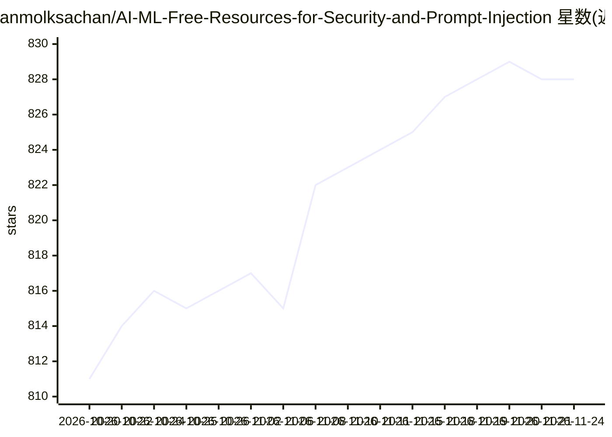

# anmolksachan/AI-ML-Free-Resources-for-Security-and-Prompt-Injection

⭐ 828 · 推送 2026-10-22 · [GitHub](https://github.com/anmolksachan/AI-ML-Free-Resources-for-Security-and-Prompt-Injection) · [官网](https://anmolksachan.github.io/LLMPenTestHub/ai-ml-roadmap-for-pentester.html) · 个人维护

**AI/ML 渗透测试入门学习路线图，聚合免费学习资源**

以阶段化路线图形式组织 AI/ML 安全学习资源：从前置基础（Web 安全、Python、API）、机器学习与 LLM 基础，到提示注入、越狱、Agentic/MCP、RAG 与向量库攻击面，再到实战练习、漏洞赏金与社区资源。全部条目以表格或列表形式链接外部课程、论文、标准、工具与数据集，并以 Foundational/Historical/Archived/Unverified 等标签标注资源状态。本仓库本身不含可运行软件，仅为资源清单。

## 筛选速览

| 维度 | 判定 | 备注 |
|---|---|---|
| AI 角色 | `ai-knowledge` | 知识聚合/清单类 |
| 许可风险 | `none` | — |
| 部署形态 | `None` |  |
| 模型依赖 | — | README 未给出锁定关系 |
| 硬件要求 | — | 无带数字的原话,不猜 |
| 安装摩擦 | `low` | 无编译、无系统依赖或容器化 |
| 成熟度 | — | 结构信号不足 |

## 能力要点

- 按 8 个阶段组织的 AI/ML 渗透测试学习路线
- 覆盖提示注入、越狱、MCP/Agent、RAG 投毒等攻击面清单
- 收录 OWASP LLM Top 10、MITRE ATLAS、NIST AI 100-2 等标准与框架链接
- 以 Foundational/Historical/Unverified 等标签标注资源状态

## 适用场景

- 为零基础转 AI/ML 安全测试规划学习路径
- 查找提示注入与 LLM 攻击的入门资料和标准文档
- 按经验水平选择课程、论文与实战平台

## 场景标签

`精选清单` `网络安全` · 领域:学习与行业

## 证据(README 行号)

> L1: # 🛡️ AI/ML Pentesting Roadmap (2026 Edition)
> L5: > A comprehensive, structured guide to learning AI/ML security and penetration testing — from zero to practitioner. 
> L10: ## 📋 Table of Contents

## 星数曲线

2026-10-20 811 → 2026-11-24 828（+17）

---
*卡片 v1 · prompt 1.4 · 生成 2026-11-24 · 置信度 mid · 依据 README sha `c29ca437ec48` · [字段定义](../../DATASET.md)*
