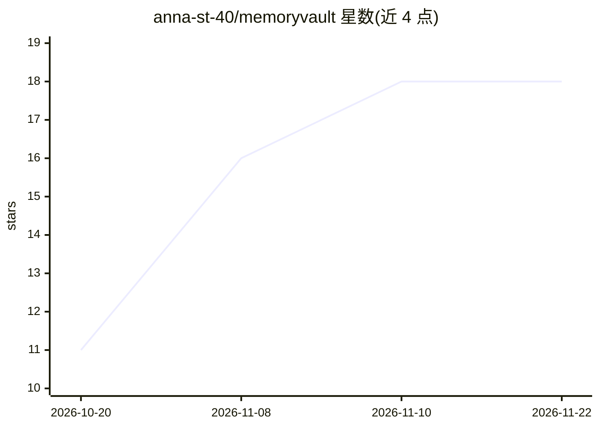

# anna-st-40/memoryvault

⭐ 18 · TypeScript · 推送 2026-10-17 · [GitHub](https://github.com/anna-st-40/memoryvault) · 个人维护

**自托管视频归档：自动转录与语义搜索的本地 AI 记忆库**

自部署的视频归档系统，由 API、Worker、Frontend 三个服务组成，通过 docker compose 一键启动。用户将视频放入指定目录后，Worker 自动转封装 MTS 文件并用 WhisperX 转录，结果写入共享 SQLite 数据库；前端提供按内容相似度浏览的语义地图。LLM 能力通过外部 Ollama 实例接入（默认 qwen3:8b），语义搜索使用 embedding 模型；支持将 TORCH_INDEX_URL 指向 CUDA 12.4 索引以启用 GPU 加速。

## 筛选速览

| 维度 | 判定 | 备注 |
|---|---|---|
| AI 角色 | `ai-native` | 本体是模型或模型工具 |
| 许可风险 | `none` | — |
| 部署形态 | `self-host` | docker 或自建部署 |
| 模型依赖 | local-ok | 支持本地模型 |
| 硬件要求 | — | 无带数字的原话,不猜 |
| 安装摩擦 | `low` | 无编译、无系统依赖或容器化 |
| 成熟度 | — | 结构信号不足 |

## 能力要点

- WhisperX 自动转录视频并写入共享 SQLite 数据库
- 语义地图按内容相似度浏览视频
- LLM 功能对接任意可达的 Ollama 实例（默认 qwen3:8b）
- docker compose 三服务一键部署（Frontend:8765 / API:8000）

## 适用场景

- 把个人视频素材库做成可搜索、可按内容浏览的归档
- 为大量录像自动生成文字记录
- 在局域网内自托管视频语义检索系统

## 场景标签

`语义搜索` `语音识别` · 领域:知识与检索

## 证据(README 行号)

> L32: 3. The worker picks them up, remuxes MTS files, transcribes with WhisperX, and writes results to the shared SQLite 
> L3: A self-hosted video archive with automatic transcription and a semantic memory map.

## 星数曲线

2026-10-20 11 → 2026-11-22 18（+7）

---
*卡片 v1 · prompt 1.4 · 生成 2026-11-18 · 置信度 high · 依据 README sha `1c265464a36d` · [字段定义](../../DATASET.md)*
