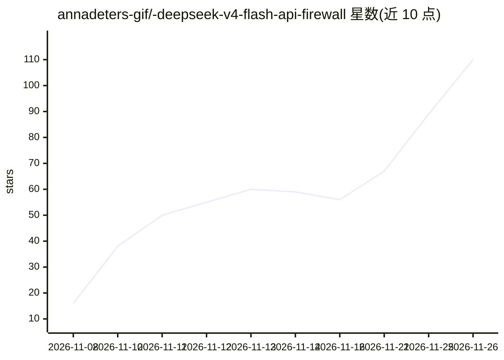

# annadeters-gif/-deepseek-v4-flash-api-firewall

⭐ 110 · 推送 2026-11-05 · [GitHub](https://github.com/annadeters-gif/-deepseek-v4-flash-api-firewall) · [官网](https://app.coregold.io/signup?invite_code=ADvlj9b) · 个人维护 · 中文 README

**面向开发者的 DeepSeek 海外 API 充值扣费风控方案文档**

一份以 README 形式呈现的结算规范文档，主题为在 Together AI、DeepInfra、Fireworks 等海外托管平台上调用 DeepSeek V4.1 Flash 时的费用控制：针对 Auto-Topup 连续划扣导致锁卡或超额账单的问题，提出使用 CoreGold 商业虚拟卡的预设硬限额作为熔断手段，并给出充值、开卡、录入注销的三步流程。内容为文字说明，仓库中未展示代码、SDK 或可运行程序。

## 筛选速览

| 维度 | 判定 | 备注 |
|---|---|---|
| AI 角色 | `ai-knowledge` | 知识聚合/清单类 |
| 许可风险 | `none` | — |
| 部署形态 | `None` |  |
| 模型依赖 | — | README 未给出锁定关系 |
| 硬件要求 | — | 无带数字的原话,不猜 |
| 安装摩擦 | `low` | 无编译、无系统依赖或容器化 |
| 成熟度 | — | 结构信号不足 |

## 能力要点

- 描述 Auto-Topup 异地风控锁卡与并发扣费穿透两类结算问题
- 提出以单卡硬限额触发 Decline 实现停机止损的防御架构
- 给出充值注资、开立专卡、录入与熔断的三步部署流程

## 适用场景

- 在海外推理平台上调度大规模 Agent 并发前预设费用上限
- 避免测试代码死循环导致绑定信用卡被连续扣费
- 为跨境小额高频自动充值配置独立虚拟卡降低锁卡风险

## 场景标签

 · 领域:云服务计费/资金风控

## 证据(README 行号)

> L2: DeepSeek V4.1 Flash 海外云托管 API 结算规范：解决连续 Auto-Topup 异地锁卡与突发并发资金穿透。
> L5: 以极致性价比著称的 DeepSeek V4.1 Flash 成为大规模 Agent 调度与实时问答的首选。许多团队在海外算力云（如 Together AI、DeepInfra、Fireworks）调用无审查实例。

## 星数曲线

2026-11-08 16 → 2026-11-26 110（+94）

---
*卡片 v1 · prompt 1.4 · 生成 2026-11-18 · 置信度 mid · 依据 README sha `799a9db96230` · [字段定义](../../DATASET.md)*
