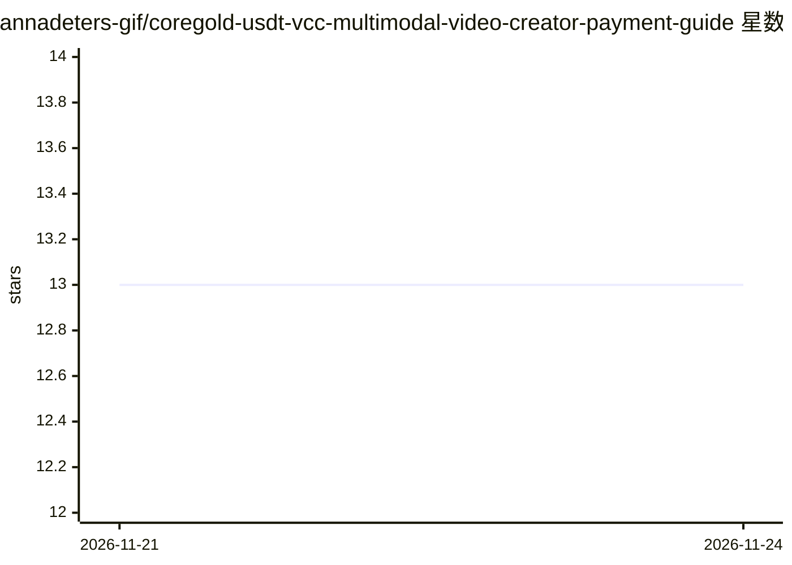

# annadeters-gif/coregold-usdt-vcc-multimodal-video-creator-payment-guide

⭐ 36 · 推送 2026-11-20 · [GitHub](https://github.com/annadeters-gif/coregold-usdt-vcc-multimodal-video-creator-payment-guide) · [官网](https://app.coregold.io/signup?invite_code=ADvlj9b) · 个人维护 · 中文 README

**出海创作者用 USDT 开虚拟卡订阅工具的指南**

面向做海外短视频、素材、独立站内容与社媒运营的创作者，梳理订阅 AI 与视频生成工具时的支付与账单管理做法：区分个人/团队计划、按场景选卡段、填写账单信息、绑定数字钱包四条建议，并给出 CoreGold 注册、USDT（TRC20）充值、申请开卡、绑定 Apple Pay / Google Pay 的分步流程。AI 与视频生成仅作为行业背景出现，核心内容是数字货币充值与虚拟卡绑定的操作教程。

## 筛选速览

| 维度 | 判定 | 备注 |
|---|---|---|
| AI 角色 | `ai-knowledge` | 知识聚合/清单类 |
| 许可风险 | `none` | — |
| 部署形态 | `None` |  |
| 模型依赖 | — | README 未给出锁定关系 |
| 硬件要求 | — | 无带数字的原话,不猜 |
| 安装摩擦 | `low` | 无编译、无系统依赖或容器化 |
| 成熟度 | — | 结构信号不足 |

## 能力要点

- 个人计划与团队计划的开卡场景区分
- USDT（TRC20）充值流程与到账说明
- 卡号/有效期/CVV 查看与 Apple Pay / Google Pay 绑定步骤
- 卡段按 AI 工具、Google Play / Apple Store、海外电商、广告投放、云服务分类

## 适用场景

- 我想订阅海外 AI 工具但被海外支付卡住，跑通 USDT 充值开卡流程
- 团队多人订阅工具，需要统一管理多张虚拟卡
- 把虚拟卡绑进手机钱包做日常工具付费

## 场景标签

`教程课程` · 领域:学习与行业

## 证据(README 行号)

> L2: 结合多模态与视频生成能力持续向更长时长、更低成本演进的行业趋势，梳理内容创作者与出海团队在订阅工具和绑定数字钱包时的实用做法，附 CoreGold 开卡指南。
> L9: ### 💡 实操干货：创作者用卡的 4 个实用建议
> L18: ### 🧭 极简开卡与绑定流程（一看就会）

## 星数曲线

2026-11-21 13 → 2026-11-24 13（+0）

---
*卡片 v1 · prompt 1.4 · 生成 2026-11-21 · 置信度 high · 依据 README sha `bb601eba4b0b` · [字段定义](../../DATASET.md)*
