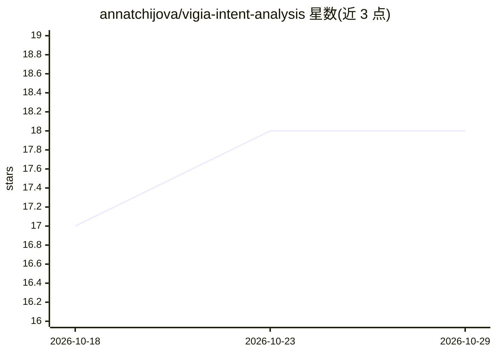

# annatchijova/vigia-intent-analysis

⭐ 18 · Python · Apache-2.0 · 推送 2026-10-21 · [GitHub](https://github.com/annatchijova/vigia-intent-analysis) · [官网](https://annatchijova.github.io/vigia/vigia.html) · 个人维护

**面向 DFIR 的溯因推理与意图分析引擎：判定证据解释背后的获益方**

服务于 SIFT 工作站的确定性推理引擎（Python，超过 10 万行生产代码），从证据中量化'证据说了什么'与'证据应当说什么'之间的断裂，产出加密密封的裁决（0/1/2/3 退出码，含 ABSTAIN），识别伪造证据与栽赃。核心评分管线不使用 LLM、零浮点（Fraction 算术）、4 个哈希 + HMAC 链；LLM 仅在裁决密封后生成叙述。提供 5 种部署模式：纯 Python、Claude Code+MCP（22 个取证工具）、Ollama 本地 LLM、批量 agent、OpenWebUI 实验模式。附带离线 Web 面板、617 个密封取证包与 4 语言学术文档。

## 筛选速览

| 维度 | 判定 | 备注 |
|---|---|---|
| AI 角色 | `ai-native` | 本体是模型或模型工具 |
| 许可风险 | `permissive` | Apache-2.0 |
| 部署形态 | `library` | 以包/库形式分发 |
| 模型依赖 | local-ok | 支持本地模型 |
| 硬件要求 | — | 无带数字的原话,不猜 |
| 安装摩擦 | `low` | 无编译、无系统依赖或容器化 |
| 成熟度 | `idea` | |

## 能力要点

- 裁决先密封、LLM 仅事后叙述的确定性评分管线（vigia_scorer.py）
- Fraction 精确算术 + 4 哈希 + HMAC 链的密封 ForensicBundle，可脱离本代码验证
- Mode 1 纯 Python 零 token 离线运行，平均 < 50ms
- 检测语料 158/162 (97.5%) 标签盲测，已知失败模式公开记录（KNOWN_LIMITATIONS.md）

## 适用场景

- 取证分析师判定攻击叙述是否被伪造或栽赃
- 需要可复现、面向 Daubert 可采性的密封裁决
- 完全离线环境（无网络、零 token）下运行意图分析

## 场景标签

`网络安全` · 领域:学习与行业

## 证据(README 行号)

> L11: **VIGÍA is not a detector. It is a deterministic inference engine that quantifies
> L25: |LLM makes the verdict|LLM narrates *after* the verdict is sealed|
> L89: The LLM never touches the scoring pipeline. It receives a sealed, cryptographically

## 星数曲线

2026-10-18 17 → 2026-10-29 18（+1）

---
*卡片 v1 · prompt 1.4 · 生成 2026-10-29 · 置信度 mid · 依据 README sha `23e5f8fef2ec` · [字段定义](../../DATASET.md)*
