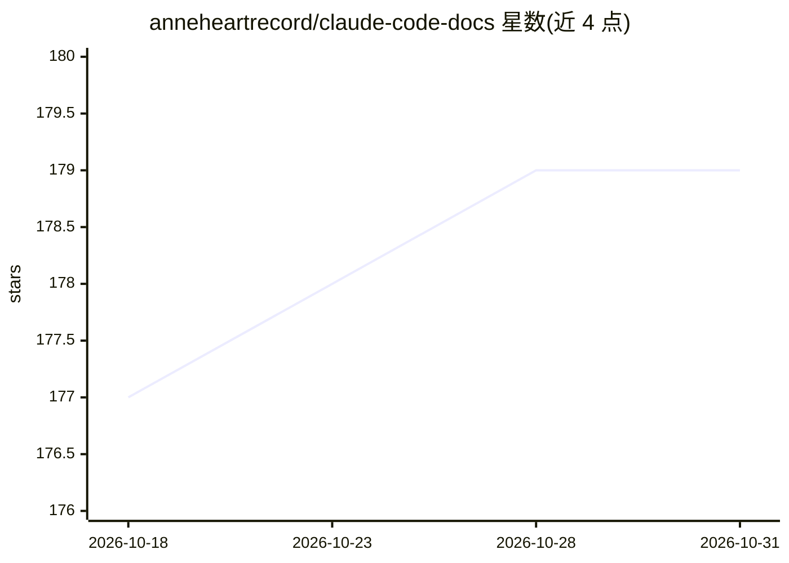

# anneheartrecord/claude-code-docs

⭐ 179 · Python · MIT · 推送 2026-08-11 · [GitHub](https://github.com/anneheartrecord/claude-code-docs) · [官网](https://www.charles-cheng.com/projects) · 个人维护 · 中文 README

**Claude Code 泄露源码的逐模块技术分析文档集（13 章，中英双语）**

基于 2026-03-31 从 npm 包 sourcemap 还原出的 Claude Code 客户端 TypeScript 源码（51.5 万行、2,766 文件），作者用 Claude Code 逐模块分析并撰写 13 篇中英双语技术文档：覆盖架构总览、Agent 六阶段循环、上下文工程、三层消息压缩、权限系统、五层记忆加载、工具与 MCP 集成，并解析 82 个 feature flag 中未发布功能。目标读者为 Agent 产品工程师与对 Agent 架构感兴趣的开发者；声明分析基于特定版本快照，接受事实纠错类 issue。提供在线阅读站点与本地链接自检脚本。

## 筛选速览

| 维度 | 判定 | 备注 |
|---|---|---|
| AI 角色 | `ai-knowledge` | 知识聚合/清单类 |
| 许可风险 | `permissive` | MIT |
| 部署形态 | `None` |  |
| 模型依赖 | — | README 未给出锁定关系 |
| 硬件要求 | — | 无带数字的原话,不猜 |
| 安装摩擦 | `low` | 无编译、无系统依赖或容器化 |
| 成熟度 | — | 结构信号不足 |

## 能力要点

- 13 篇中英双语章节，覆盖 Agent 循环、上下文工程、压缩、权限、记忆、MCP 等
- 解析 82 个 feature flag 中的未发布功能（Kairos、Context Collapse、语音模式）
- 明确标注分析基于 2026-03-31 源码快照（v2.1.888），并跟踪版本漂移
- MIT 许可覆盖原创分析内容，提供在线阅读站点

## 适用场景

- 学习 Claude Code 客户端架构与 Agent 循环实现细节
- 为自研 Agent 产品的权限、压缩、记忆设计寻找参考
- 了解 AI Coding 时代的 Code Review 与 Agent 安全设计思路

## 场景标签

`教程课程` · 领域:学习与行业

## 证据(README 行号)

> L28: 我用 Claude Code 对这份源码做了系统化的技术分析，逐模块拆解，写了 13 篇技术文档，中英双语。
> L30: 从架构设计到 Agent 循环的六阶段实现，从三层消息压缩体系到权限校验系统，从五层记忆加载到工具的执行流水线。

## 星数曲线

2026-10-18 177 → 2026-10-31 179（+2）

---
*卡片 v1 · prompt 1.4 · 生成 2026-10-23 · 置信度 high · 依据 README sha `713963269a5b` · [字段定义](../../DATASET.md)*
