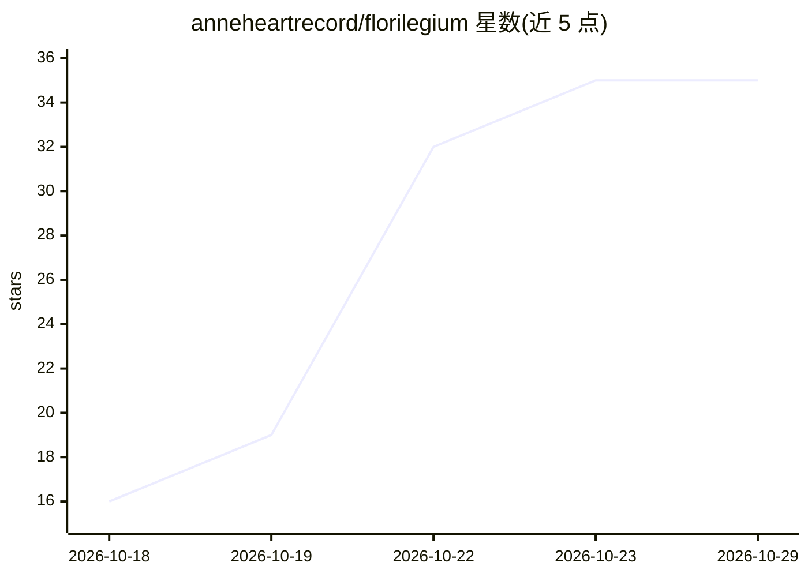

# anneheartrecord/florilegium

⭐ 35 · Shell · MIT · 推送 2026-10-26 · [GitHub](https://github.com/anneheartrecord/florilegium) · 个人维护 · 中文 README

**本地 agent workflow：视频链接/文字稿转成 Obsidian 阅读笔记**

运行时无关的本地 agent workflow：输入 YouTube、B 站等视频链接或直接给文字稿，通过 yt-dlp 抓取字幕（三级取文：字幕直抓→faster-whisper 本地转写→bgutil PO-token 解锁后转写），清洗后整理成一篇中立可读的文章，写入 Obsidian vault 的「他山之石」目录。适配任何能读取 SKILL.md 并调用 shell/Python 脚本的 agent runtime，提供 Claude Code 与 Codex 的可选放置路径。全免费、纯本地，除视频平台取数外无内容外传。依赖 Python 3.10+、Node.js、deno。

## 筛选速览

| 维度 | 判定 | 备注 |
|---|---|---|
| AI 角色 | `ai-native` | 本体是模型或模型工具 |
| 许可风险 | `permissive` | MIT |
| 部署形态 | `None` |  |
| 模型依赖 | — | README 未给出锁定关系 |
| 硬件要求 | — | 无带数字的原话,不猜 |
| 安装摩擦 | `low` | 无编译、无系统依赖或容器化 |
| 成熟度 | — | 结构信号不足 |

## 能力要点

- 三级取文：yt-dlp 字幕直抓 / faster-whisper 本地转写 / bgutil PO-token 解锁
- 输出为中立可读文章并区分事实与推测、标注作者立场
- 输出直接落入 Obsidian vault，文件名采用作者前置命名
- 运行时无关：任何可读 SKILL.md 并调用脚本的 agent 均可适配

## 适用场景

- 把看过的视频/播客观点一键剪藏进 Obsidian 知识库
- B 站无字幕视频本地转写后整理成文章
- 在 Claude Code、Codex 或其他 agent 中用一句话触发剪藏流程

## 场景标签

`知识库管理` `语音识别` · 领域:知识与检索

## 证据(README 行号)

> L10: 一个运行时无关的本地 agent workflow：给它一个 YouTube、B 站、播客或其他视频链接（也可以直接给文字稿），它会抓字幕或转写音频，再把内容整理成一篇**可直接阅读的文章**，写进你的 Obsidian 知识库的
> L30:  2. 没字幕但音频可取 → 本地 `faster-whisper` 转写。B 站无字幕视频走这条。

## 星数曲线

2026-10-18 16 → 2026-10-29 35（+19）

---
*卡片 v1 · prompt 1.4 · 生成 2026-10-25 · 置信度 high · 依据 README sha `26b5c882a2c3` · [字段定义](../../DATASET.md)*
