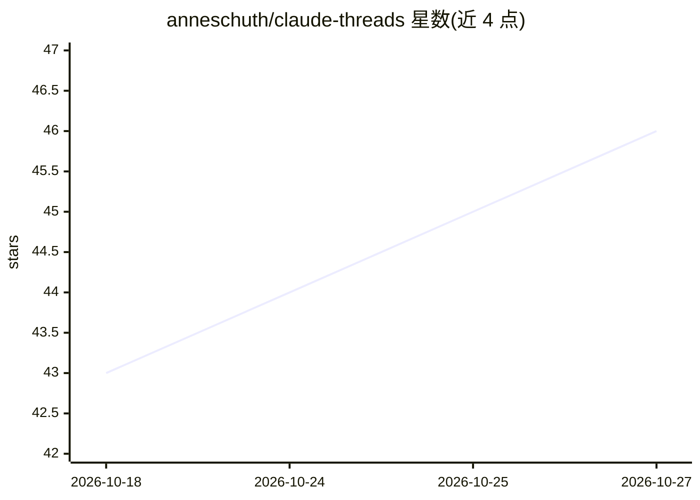

# anneschuth/claude-threads

⭐ 46 · TypeScript · Apache-2.0 · 推送 2026-10-21 · [GitHub](https://github.com/anneschuth/claude-threads) · [官网](https://claude-threads.run) · 个人维护

**在 Slack/Mattermost 中驱动 Claude Code 的团队协作机器人**

运行在用户本机的聊天机器人：在 Slack 或 Mattermost 频道中 @提及即可在本机工作目录中启动 Claude Code 会话，输出、diff、任务列表与权限提示实时流入线程，队友通过回复或 emoji 表情介入与审批。支持多工作区、并发会话、Git worktree 隔离、定时任务与事件触发、频道共享记忆、文件双向传输（含语音转写）、多账号池轮换。使用已有 Claude 订阅或 API key，无需云端沙箱；限制是需自行托管在有仓库的机器上。通过 npm/Bun 全局安装，要求 Bun 1.2.21+ 或 Node 20+ 及 Claude Code CLI。

## 筛选速览

| 维度 | 判定 | 备注 |
|---|---|---|
| AI 角色 | `ai-ecosystem` | LLM/agent 周边工具 |
| 许可风险 | `permissive` | Apache-2.0 |
| 部署形态 | `library` | 以包/库形式分发 |
| 模型依赖 | — | README 未给出锁定关系 |
| 硬件要求 | — | 无带数字的原话,不猜 |
| 安装摩擦 | `low` | 无编译、无系统依赖或容器化 |
| 成熟度 | — | 结构信号不足 |

## 能力要点

- Claude Code 会话实时流入 Slack/Mattermost 线程，emoji 审批权限与计划
- 每线程一个会话，本地 checkout、MCP 服务器与插件随用
- !routine 定时任务与 !watch 事件触发，频道级共享记忆
- 多账号池按订阅余量分配会话并冷却限流账号

## 适用场景

- 团队在聊天频道里围观并引导 Claude 改代码
- 自托管 Mattermost 环境下让编码 agent 留在内网
- 把日常巡检、事件分诊做成定时或触发的例行会话

## 场景标签

`编码 Agent` `聊天机器人` · 领域:编码与开发

## 证据(README 行号)

> L17: **Run Claude Code from your team's chat.** The bot lives on your machine, next to your checkout and your local tool
> L30: 2. It spawns a real Claude Code session in a working directory on your machine.

## 星数曲线

2026-10-18 43 → 2026-10-27 46（+3）

---
*卡片 v1 · prompt 1.4 · 生成 2026-10-25 · 置信度 high · 依据 README sha `478125fcc43f` · [字段定义](../../DATASET.md)*
