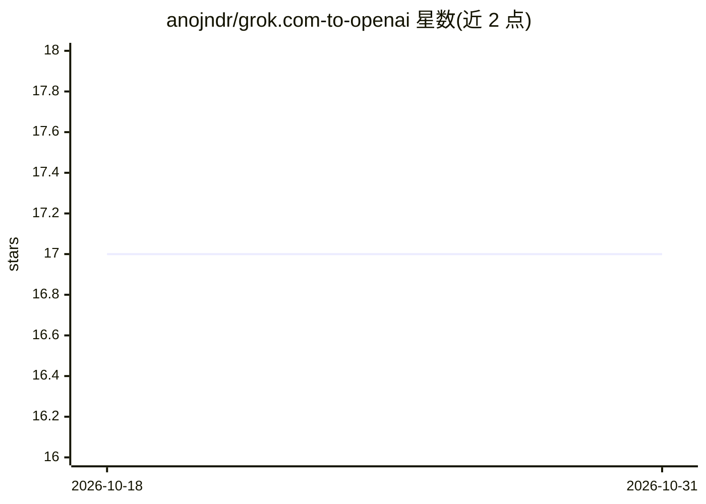

# anojndr/grok.com-to-openai

⭐ 17 · Python · 推送 2026-10-01 · [GitHub](https://github.com/anojndr/grok.com-to-openai) · 个人维护

**把 grok.com 免费网页账号转成 OpenAI 兼容 API 的代理**

基于 FastAPI 的代理服务器：复用 grok.com 已认证的网页会话（Netscape cookie 账号池），对外暴露 /v1/chat/completions、/v1/responses、/v1/models 等 OpenAI 兼容端点，支持流式、文件上传与图片生成（经 Grok Imagine WebSocket 路由）。账号池支持轮询、会话粘性、限流冷却与热重载，多轮会话与附件记忆用 SQLite 持久化。限制：免费账号约每小时 7 次对话查询，需自行提供账号 cookie 与 freeimage.host API key。

## 筛选速览

| 维度 | 判定 | 备注 |
|---|---|---|
| AI 角色 | `ai-ecosystem` | LLM/agent 周边工具 |
| 许可风险 | `none` | — |
| 部署形态 | `library` | 以包/库形式分发 |
| 模型依赖 | — | README 未给出锁定关系 |
| 硬件要求 | — | 无带数字的原话,不猜 |
| 安装摩擦 | `low` | 无编译、无系统依赖或容器化 |
| 成熟度 | — | 结构信号不足 |

## 能力要点

- OpenAI 兼容的 chat completions 与 Responses API 端点（流式/非流式）
- 账号池负载均衡：会话粘性、限流冷却、热重载与故障迁移
- 跨轮附件记忆：文件 id 按会话记忆并按内容哈希去重，SQLite 持久化
- 检测并隔离输出退化（word-salad）的账号，请求自动切换健康账号

## 适用场景

- 用现有 OpenAI SDK/客户端调用 grok.com 的免费账号额度
- 多账号池分摊 grok.com 免费额度并自动处理限流
- 在 llmcord-go 等工具中接入 Grok 并展示搜索来源

## 场景标签

`模型网关` · 领域:Agent 开发

## 证据(README 行号)

> L3: Turn grok.com free accounts into an OpenAI-compatible API using FastAPI.
> L17: |`POST /v1/chat/completions`|Chat Completions API (stream + non-stream)|
> L147: server.py          FastAPI app, OpenAI-compatible endpoints

## 星数曲线

2026-10-18 17 → 2026-10-31 17（+0）

---
*卡片 v1 · prompt 1.4 · 生成 2026-10-29 · 置信度 high · 依据 README sha `9e1ce19badab` · [字段定义](../../DATASET.md)*
