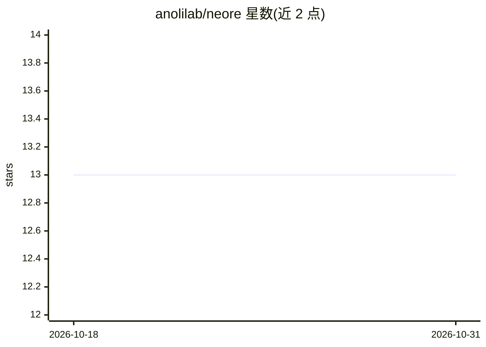

# anolilab/neore

⭐ 13 · TypeScript · NOASSERTION · 推送 2026-10-30 · [GitHub](https://github.com/anolilab/neore) · 个人维护

**多模型 AI 聊天应用：网页端+浏览器扩展，自托管部署**

基于 TanStack Start（React 19）与 Lunora 后端（Cloudflare Workers，D1/R2/Durable Objects）的 AI 聊天应用，支持多模型对话、文档与图片处理，含浏览器扩展；文档解析、浏览器渲染、内容审核与嵌入由 Hono/Rust Workers 承担，多个 AI 供应商经 LLM gateway 路由。面向自托管开发者：需 Node.js 22.22、pnpm 12 与 Rust 工具链（首次构建 document-parser Worker），并需至少一个 AI 供应商 key。许可为 FSL-1.1-ALv2（source-available，非 OSI 开源），部署经 Alchemy 在 CI 中执行，本地部署仅限维护者。

## 筛选速览

| 维度 | 判定 | 备注 |
|---|---|---|
| AI 角色 | `ai-native` | 本体是模型或模型工具 |
| 许可风险 | `none` | NOASSERTION |
| 部署形态 | `library` | 以包/库形式分发 |
| 模型依赖 | — | README 未给出锁定关系 |
| 硬件要求 | — | 无带数字的原话,不猜 |
| 安装摩擦 | `low` | 无编译、无系统依赖或容器化 |
| 成熟度 | — | 结构信号不足 |

## 能力要点

- 多供应商模型路由，经自建 LLM gateway 接入
- 文档/图片处理由 Hono 与 Rust Workers 服务承担
- monorepo 结构，pnpm workspaces + vis 任务运行器
- 含浏览器扩展（CRXJS + React）

## 适用场景

- 自托管一个支持多模型的 AI 聊天服务
- 在浏览器中通过扩展使用聊天功能
- 在对话中处理文档与图片

## 场景标签

`聊天机器人` · 领域:对话与助手

## 证据(README 行号)

> L3: An AI chat application: multi-model conversations, tools, document and image
> L113: - **AI**: Multiple providers routed through the LLM gateway

## 星数曲线

2026-10-18 13 → 2026-10-31 13（+0）

---
*卡片 v1 · prompt 1.4 · 生成 2026-10-31 · 置信度 mid · 依据 README sha `a56ba7c68f2d` · [字段定义](../../DATASET.md)*
