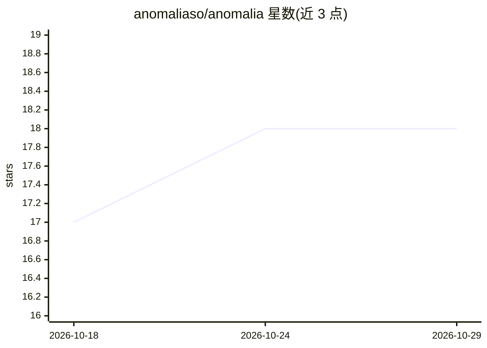

# anomaliaso/anomalia

⭐ 18 · TypeScript · Apache-2.0 · 推送 2026-09-20 · [GitHub](https://github.com/anomaliaso/anomalia) · [官网](https://anomalia.so) · 组织维护

**自动化营销部门：规划、撰写并发布社媒/博客/SEO 内容**

开源的营销自动化应用，自我定位为 Grok Bot 的替代方案：生成每周编辑计划、社媒帖子、轮播图与视频草稿，覆盖博客、SEO 与 GEO；内容需经用户批准后才发布，支持从应用、邮件、CLI 或 MCP 批准。包含品牌资料库（Studio）与新闻雷达（Radar）。技术栈为 TypeScript/SvelteKit + Supabase，需 Node.js 22 与 Docker Compose 自托管，也可使用托管服务。

## 筛选速览

| 维度 | 判定 | 备注 |
|---|---|---|
| AI 角色 | `ai-native` | 本体是模型或模型工具 |
| 许可风险 | `permissive` | Apache-2.0 |
| 部署形态 | `self-host` | docker 或自建部署 |
| 模型依赖 | — | README 未给出锁定关系 |
| 硬件要求 | — | 无带数字的原话,不猜 |
| 安装摩擦 | `low` | 无编译、无系统依赖或容器化 |
| 成熟度 | — | 结构信号不足 |

## 能力要点

- 生成编辑计划、帖子、轮播图与视频草稿，覆盖社媒/博客/SEO/GEO
- propose-approve 机制：AI 不经批准不发布
- Studio 品牌资料库与 Radar 新闻/对话转草稿与线索回复
- CLI 与 MCP 服务器支持从 Cursor/Claude 驱动

## 适用场景

- 自动生成并排期品牌社媒与博客内容
- 多品牌团队的营销内容审批与发布
- 追踪新闻与对话并生成草稿和线索回复
- 提升 Google 排名与被 AI 助手引用（GEO）

## 场景标签

`AI 写作` `工作流自动化` `图像生成` · 领域:效率与自动化

## 证据(README 行号)

> L12: Your marketing department, automated. Anomalia is an open-source Grok Bot
> L20: - Weekly editorial plan, then on-brand posts, carousels, and video
> L28: - Drive it from Cursor or Claude via MCP, or from the `anomalia` CLI

## 星数曲线

2026-10-18 17 → 2026-10-29 18（+1）

---
*卡片 v1 · prompt 1.4 · 生成 2026-10-29 · 置信度 high · 依据 README sha `7e45a32ac5e8` · [字段定义](../../DATASET.md)*
