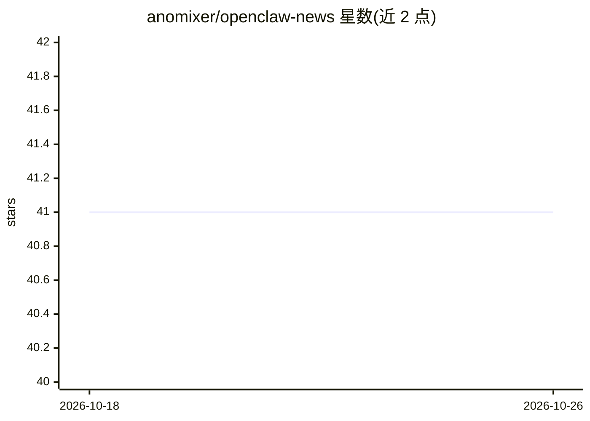

# anomixer/openclaw-news

⭐ 41 · JavaScript · 推送 2026-10-25 · [GitHub](https://github.com/anomixer/openclaw-news) · [官网](https://anomixer.github.io/openclaw-news/) · 个人维护 · 中文 README

**OpenClaw 生态每日新闻日志兼 Windows/WSL2 安装指南**

以日志流形式记录 OpenClaw 项目及其周边生态动态的资讯仓库：每日条目覆盖版本发布、star 增长、安全事件、监管动态、开源模型权重发布（Kimi/MiniMax/InternLM 等）与社区事件，并按安全、生态、历史、AI 对比、'龙虾哲学'分栏组织。另附 OpenClaw + Ollama + Telegram 的 Windows 基础与 WSL2 完整安装指南、迁移与模型选择指引。内容以中英双语链接导航呈现。

## 筛选速览

| 维度 | 判定 | 备注 |
|---|---|---|
| AI 角色 | `ai-knowledge` | 知识聚合/清单类 |
| 许可风险 | `none` | — |
| 部署形态 | `library` | 以包/库形式分发 |
| 模型依赖 | — | README 未给出锁定关系 |
| 硬件要求 | — | 无带数字的原话,不猜 |
| 安装摩擦 | `low` | 无编译、无系统依赖或容器化 |
| 成熟度 | — | 结构信号不足 |

## 能力要点

- 按日期倒序的日志流记录 OpenClaw 生态每日动态
- 六大部分：日志、安全与合规、生态、历史、AI 对比、社区语录
- OpenClaw + Ollama + Telegram 快速安装指南（Windows/WSL2）
- 中英双语 README 与网页版

## 适用场景

- 追踪 OpenClaw 项目版本、star 里程碑与社区事件
- 按 Windows 或 WSL2 路线安装配置 OpenClaw + Ollama + Telegram
- 了解安全事件、监管动态与开源模型发布资讯

## 场景标签

`精选清单` · 领域:学习与行业

## 证据(README 行号)

> L24: - **Part 1: 📅 Daily Battlefield News (The Logs)**
> L71: Because the battle is too fierce, to save everyone from scrolling through updates from the beginning every day, thi

## 星数曲线

2026-10-18 41 → 2026-10-26 41（+0）

---
*卡片 v1 · prompt 1.4 · 生成 2026-10-25 · 置信度 mid · 依据 README sha `99e13f252086` · [字段定义](../../DATASET.md)*
