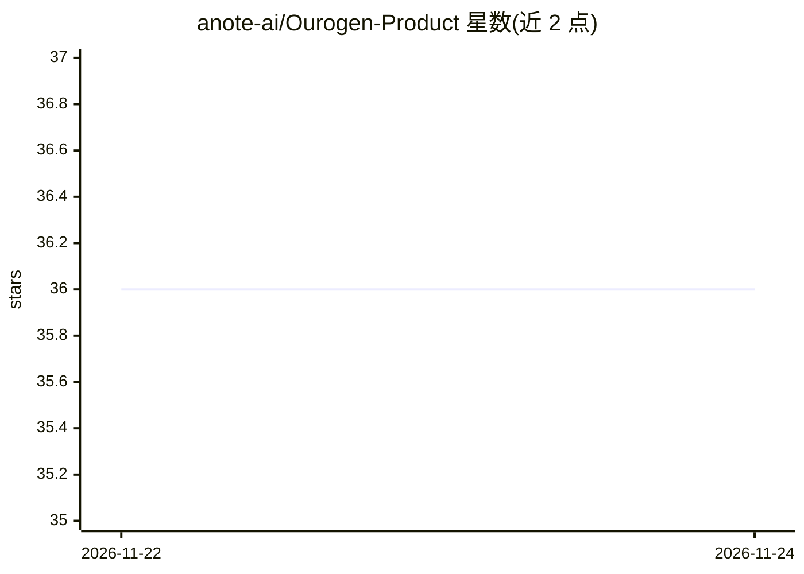

# anote-ai/Ourogen-Product

⭐ 36 · Python · Apache-2.0 · 推送 2026-11-23 · [GitHub](https://github.com/anote-ai/Ourogen-Product) · [官网](https://chat.anote.ai/) · 组织维护

**面向开发者的多智能体 AI 系统框架与配套助手**

Anote 的 monorepo，包含多智能体 AI 系统的核心组件：Orchestrator 负责任务分配、执行与监控，Agent 为自主执行单元，多个 Agent 组成 Crew 按顺序或分层 Workflow 协作。产品形态覆盖 Web 聊天应用、Flask 后端、npm 发布的编码 CLI、VS Code 扩展、Electron 桌面端与移动端。内置 Agent Registry 提供编码、RFP 撰写、邮件营销、求职等领域的领域 Agent。本地启动通过 docker compose 一键拉起 web、backend、MySQL、Redis 与 Tika。

## 筛选速览

| 维度 | 判定 | 备注 |
|---|---|---|
| AI 角色 | `ai-ecosystem` | LLM/agent 周边工具 |
| 许可风险 | `permissive` | Apache-2.0 |
| 部署形态 | `self-host` | docker 或自建部署 |
| 模型依赖 | — | README 未给出锁定关系 |
| 硬件要求 | — | 无带数字的原话,不猜 |
| 安装摩擦 | `low` | 无编译、无系统依赖或容器化 |
| 成熟度 | `idea` | |

## 能力要点

- Orchestrator/Crew/Workflow 多智能体协作架构
- docker compose 一键启动 web、backend、MySQL、Redis、Tika
- Agent Registry 内置编码、RFP、外联、求职等领域 Agent
- npm CLI、VS Code 扩展、Electron 桌面端等多种分发形式

## 适用场景

- 自动化功能实现与 pull request 流程
- 批量生成与发送定制化外联邮件
- 为开发者搭建与部署协作式多 Agent 系统

## 场景标签

`Agent 框架` `多智能体` `编码 Agent` · 领域:Agent 开发

## 证据(README 行号)

> L22: Ourogen grew out of Autonomous Intelligence, an open-source research project by
> L32: |**Orchestrator**|Central hub for task assignment, execution, and monitoring. Manages agent interactions and refine
> L37: |**Models**|Backbone of intelligent agents, enabling capabilities like natural language understanding and reasoning

## 星数曲线

2026-11-22 36 → 2026-11-24 36（+0）

---
*卡片 v1 · prompt 1.4 · 生成 2026-11-22 · 置信度 high · 依据 README sha `c88c1d8fac57` · [字段定义](../../DATASET.md)*
