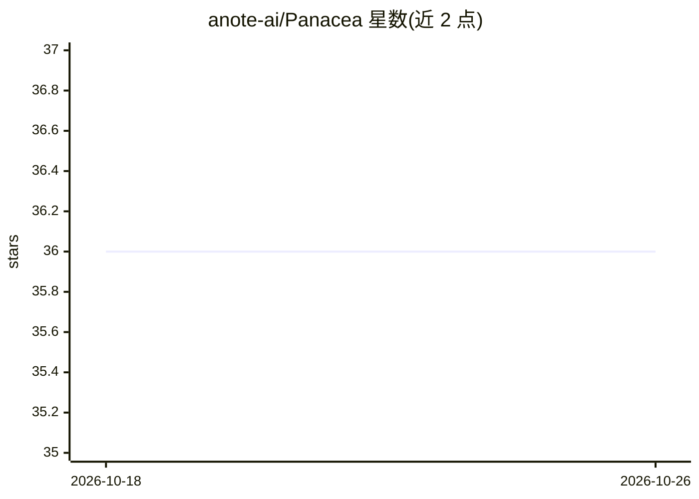

# anote-ai/Panacea

⭐ 36 · Python · Apache-2.0 · 推送 2026-10-18 · [GitHub](https://github.com/anote-ai/Panacea) · [官网](https://chat.anote.ai/) · 组织维护

**构建协作式多智能体 AI 系统的开源框架**

Anote 维护的开源研究项目，提供创建、部署和协调专用 AI 智能体的基础设施：核心组件包括负责任务分配的 Orchestrator、自主执行任务的 Agent、Task、Crew 协作组、顺序/分层 Workflow，以及模型接入（GPT、Claude、Mistral、Gemini、Llama）和工具（搜索、数据提取、文件上传等）。面向开发者和组织构建智能体系统，内置领域 Agent 注册表，示例场景含 AI 辅助编码、RFP 撰写、外联营销与求职申请。本地启动基于 Docker Compose（前端、后端、MySQL、Redis、Tika），另有 VS Code 扩展与 npm CLI 包的发布流程。

## 筛选速览

| 维度 | 判定 | 备注 |
|---|---|---|
| AI 角色 | `ai-ecosystem` | LLM/agent 周边工具 |
| 许可风险 | `permissive` | Apache-2.0 |
| 部署形态 | `self-host` | docker 或自建部署 |
| 模型依赖 | — | README 未给出锁定关系 |
| 硬件要求 | — | 无带数字的原话,不猜 |
| 安装摩擦 | `low` | 无编译、无系统依赖或容器化 |
| 成熟度 | — | 结构信号不足 |

## 能力要点

- Orchestrator/Agent/Task/Crew/Workflow 核心组件架构
- 支持 GPT、Claude、Mistral、Gemini、Llama 等模型接入
- Docker Compose 一键启动前端、后端、MySQL、Redis、Tika
- 提供 VS Code 扩展与 npm CLI 包发布流程

## 适用场景

- 构建多个专用智能体协作完成复杂任务的系统
- 自动化外联营销、RFP 撰写等业务流程
- 在本地快速部署并扩展多智能体应用

## 场景标签

`Agent 框架` `多智能体` · 领域:Agent 开发

## 证据(README 行号)

> L3: Autonomous Intelligence is an open-source research project by Anote that enables collaborative multi-agent AI system
> L11: |**Orchestrator**|Central hub for task assignment, execution, and monitoring. Manages agent interactions and refine

## 星数曲线

2026-10-18 36 → 2026-10-26 36（+0）

---
*卡片 v1 · prompt 1.4 · 生成 2026-10-25 · 置信度 high · 依据 README sha `0e4166e7b44f` · [字段定义](../../DATASET.md)*
