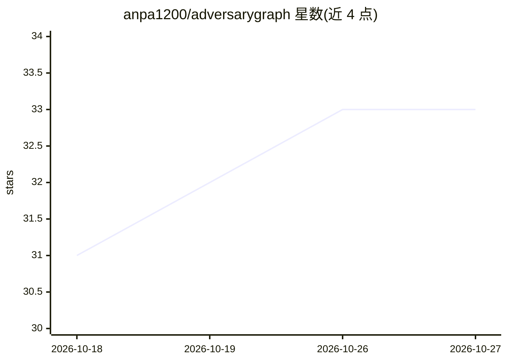

# anpa1200/adversarygraph

⭐ 33 · HTML · NOASSERTION · 推送 2026-10-20 · [GitHub](https://github.com/anpa1200/adversarygraph) · [官网](https://1200km.com/adversarygraph/) · 个人维护

**自托管 AI 辅助 CTI 转检测工程工作台（ATT&CK 映射/IOC/CVE/仿真）**

面向安全分析师的自托管威胁情报到检测工程平台：AI 辅助摄取威胁报告（文本/PDF/DOCX），生成经分析师评审的 ATT&CK/ATLAS 映射；提供 Threat Radar 早期预警（CVE/KEV/PoC 信号）、IOC 富化与 VirusTotal 查询、CVE 库（NVD/KEV 同步）、恶意软件静态分诊、PCAP 确定性分析、TTP 攻击仿真与 SIEM 验证，并以 Evidence-to-Detection Graph 保留从证据到检测规则的完整推理链。核心机制是混合 RAG（PostgreSQL 全文 + pgvector）与治理式 AI 评审：AI 输出仅为草稿，需分析师确认；基础平台可不配置 AI 运行。通过 Docker Compose 以九个镜像部署。

## 筛选速览

| 维度 | 判定 | 备注 |
|---|---|---|
| AI 角色 | `ai-enhanced` | 去掉 AI 部分产品仍成立 |
| 许可风险 | `none` | NOASSERTION |
| 部署形态 | `self-host` | docker 或自建部署 |
| 模型依赖 | local-ok | 支持本地模型 |
| 硬件要求 | — | 无带数字的原话,不猜 |
| 安装摩擦 | `low` | 无编译、无系统依赖或容器化 |
| 成熟度 | — | 结构信号不足 |

## 能力要点

- AI 辅助报告摄取生成待评审的 ATT&CK/ATLAS 映射
- Evidence-to-Detection Graph 保留证据到检测规则的完整推理链
- 统一混合 RAG：PostgreSQL 全文检索 + pgvector，答案绑定引用
- Threat Radar 早期预警与 IOC/CVE/KEV 情报关联、攻击仿真与 SIEM 验证

## 适用场景

- 把威胁报告转化为经评审的 ATT&CK 映射与检测工程工作项
- 基于 CVE/KEV/PoC 信号做产品安全早期预警与资产暴露评估
- 在隔离环境中对恶意样本做静态分诊与 AI 摘要
- 通过攻击仿真验证 SIEM 检测规则并追踪验证结果

## 场景标签

`网络安全` · 领域:学习与行业

## 证据(README 行号)

> L90: AdversaryGraph helps analysts turn threat reports, IOC evidence, CVE vulnerability context, malware-analysis leads,
> L120: AdversaryGraph is not a managed SaaS, not a multi-tenant security platform, and not a replacement for analyst vali
> L153: Edit `.env` and set strong local secrets. AI features are optional for the base

## 星数曲线

2026-10-18 31 → 2026-10-27 33（+2）

---
*卡片 v1 · prompt 1.4 · 生成 2026-10-25 · 置信度 high · 依据 README sha `a5093242566c` · [字段定义](../../DATASET.md)*
