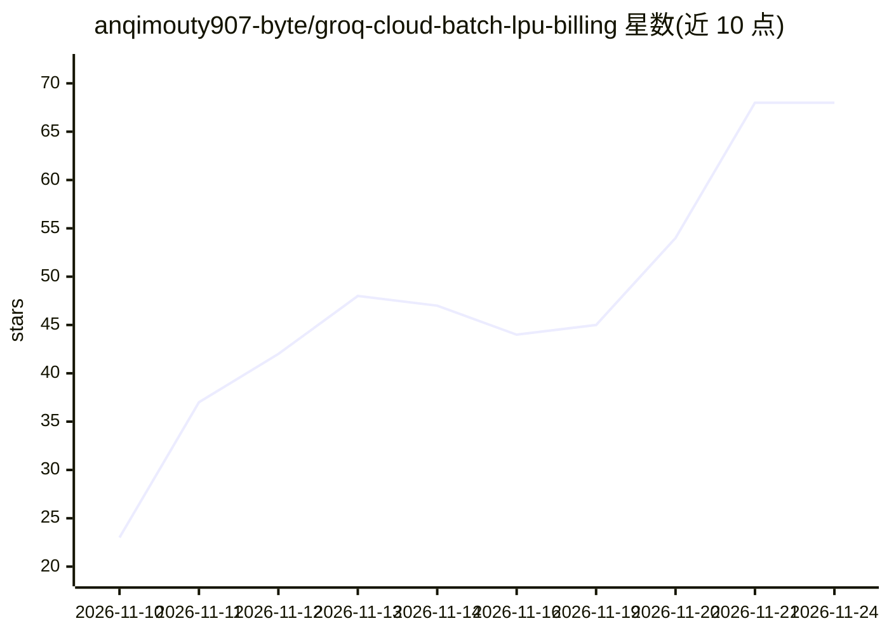

# anqimouty907-byte/groq-cloud-batch-lpu-billing

⭐ 68 · 推送 2026-11-06 · [GitHub](https://github.com/anqimouty907-byte/groq-cloud-batch-lpu-billing) · [官网](https://app.coregold.io/signup?invite_code=ADvlj9b) · 组织维护 · 中文 README

**推广 CoreGold 虚拟卡为 Groq Cloud API 充值扣款的服务页**

该仓库 README 并非软件项目，而是 CoreGold 商业卡段（414742/428837）的推广文案：针对 Groq Cloud 按量计费 Auto-Reload 在国内双币卡上频繁拒付导致 API 中断的问题，宣传用其企业卡段绑定 Groq 控制台完成自动扣款，流程为 USDT 入金、开通卡段、绑定 AVS 地址。仓库无代码、无安装或运行内容，仅含入口链接与一段十六进制字符串。

## 筛选速览

| 维度 | 判定 | 备注 |
|---|---|---|
| AI 角色 | `ai-ecosystem` | LLM/agent 周边工具 |
| 许可风险 | `none` | — |
| 部署形态 | `None` |  |
| 模型依赖 | — | README 未给出锁定关系 |
| 硬件要求 | — | 无带数字的原话,不猜 |
| 安装摩擦 | `low` | 无编译、无系统依赖或容器化 |
| 成熟度 | — | 结构信号不足 |

## 能力要点

- 面向 Groq Cloud Auto-Reload 扣款场景的虚拟卡服务说明
- 宣传企业卡段单卡硬限额与预算熔断
- 流程为 USDT 入金→开卡→绑定 Groq 控制台

## 适用场景

- 了解针对 Groq API 计费拒付问题的第三方支付方案宣传
- 无实际可安装或运行的软件用途

## 场景标签

 · 领域:云 API 计费/支付服务

## 证据(README 行号)

> L24: + CoreGold 商业卡段 (414742 / 428837):
> L31: 1. **入金充值**：进入 CoreGold 控制台 充入 USDT，秒转 USD 资金池。
> L32: 2. **派发生产卡**：开通企业卡段，备注填写 `Groq-Batch-Inference`，单卡限额设为生产预算（如 $100）。

## 星数曲线

2026-11-10 23 → 2026-11-24 68（+45）

---
*卡片 v1 · prompt 1.4 · 生成 2026-11-18 · 置信度 low · 依据 README sha `2341b7f9c189` · [字段定义](../../DATASET.md)*
