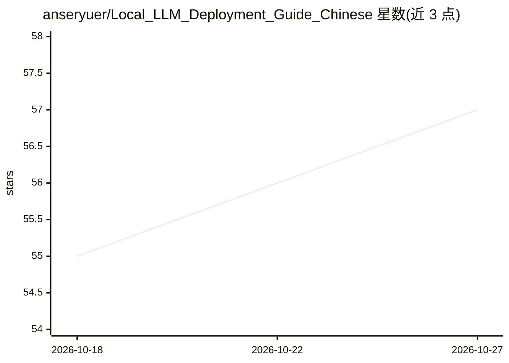

# anseryuer/Local_LLM_Deployment_Guide_Chinese

⭐ 57 · MIT · 推送 2026-10-21 · [GitHub](https://github.com/anseryuer/Local_LLM_Deployment_Guide_Chinese) · 个人维护 · 中文 README

**面向零基础用户的本地 LLM 部署中文教学长文**

一篇个人维护的长篇中文教程，指导读者在自己的电脑上部署和运行大语言模型：从查看硬件配置、用 LM Studio/Ollama 十分钟跑起第一个模型，到讲解 Token、量化、上下文长度、显存带宽与算力等原理，并延伸到多显卡并行与多人共用的服务器部署。不要求读者会编程或懂机器学习，按新手/进阶/原理三层标记内容并提供多条阅读路线。文中以 LM Studio 和 Ollama 为入门工具，提及它们底层基于 llama.cpp。

## 筛选速览

| 维度 | 判定 | 备注 |
|---|---|---|
| AI 角色 | `ai-knowledge` | 知识聚合/清单类 |
| 许可风险 | `permissive` | MIT |
| 部署形态 | `desktop` | 安装包/桌面程序 |
| 模型依赖 | — | README 未给出锁定关系 |
| 硬件要求 | — | 无带数字的原话,不猜 |
| 安装摩擦 | `medium` | 含编译或系统依赖之一 |
| 成熟度 | — | 结构信号不足 |

## 能力要点

- 按读者情况提供多条阅读路线（个人跑通/选购硬件/团队部署/原理探究）
- 第 0 步给出按可用显存估算可运行模型大小的对照表
- 覆盖 LM Studio 与 Ollama 两种入门部署路径及 OpenAI 兼容本地 API
- 以乘除法估算生成速度，区分 memory-bound 与 compute-bound

## 适用场景

- 我在自己电脑上跑起第一个本地大模型
- 我想判断现有硬件能跑多大的模型、大概多快
- 我要给团队或公司部署一个共用的模型服务
- 我想搞懂量化、上下文长度、显存带宽这些概念

## 场景标签

`教程课程` · 领域:学习与行业

## 证据(README 行号)

> L1: # 本地部署大语言模型的中文教学
> L14: 这篇文章会**手把手**带你走：先看看自己的电脑能干什么，然后十分钟内跑起第一个模型，再一点点弄懂背后到底发生了什么。
> L27: 这篇文章很长，但你**完全不用从头读到尾**。找到最像你的那一行，按顺序点过去就好：

## 星数曲线

2026-10-18 55 → 2026-10-27 57（+2）

---
*卡片 v1 · prompt 1.4 · 生成 2026-10-24 · 置信度 mid · 依据 README sha `41b1e8ee6dc7` · [字段定义](../../DATASET.md)*
