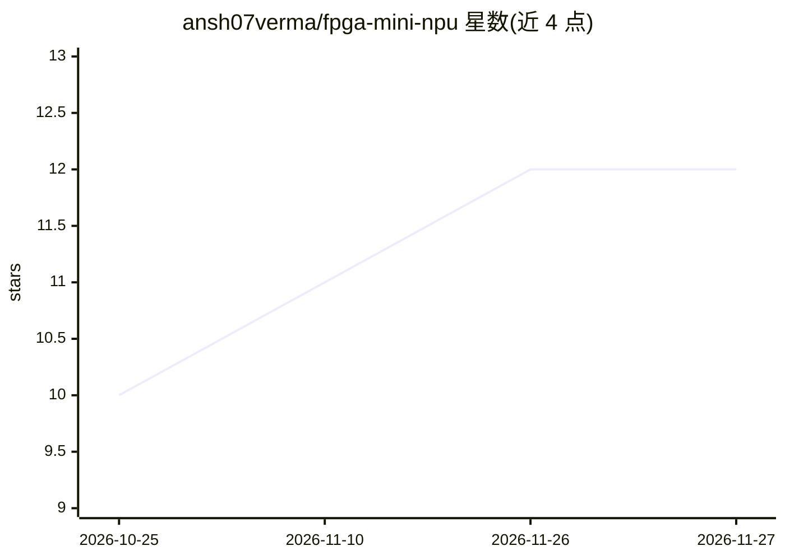

# ansh07verma/fpga-mini-npu

⭐ 12 · Verilog · 推送 2026-05-25 · [GitHub](https://github.com/ansh07verma/fpga-mini-npu) · 个人维护

**教学用 FPGA NPU：Verilog 实现的 INT8 脉动阵列 CNN 加速器**

用 Verilog RTL 实现的小型神经处理单元（NPU），核心是 weight-stationary 4×4 脉动阵列做 INT8 矩阵乘法，每个 PE 为两级流水 MAC，累加器 24 位防溢出。提供 PowerShell 仿真脚本跑 MAC、阵列与整芯片测试平台，Python golden model 生成对照测试向量，经 Vivado 综合到 Basys3（XC7A35T @ 100 MHz）。设计定位教学演示，未含 BRAM 权重缓冲、DMA/AXI 接口，列有后续改进路线。

## 筛选速览

| 维度 | 判定 | 备注 |
|---|---|---|
| AI 角色 | `ai-native` | 本体是模型或模型工具 |
| 许可风险 | `none` | — |
| 部署形态 | `None` |  |
| 模型依赖 | — | README 未给出锁定关系 |
| 硬件要求 | — | 无带数字的原话,不猜 |
| 安装摩擦 | `low` | 无编译、无系统依赖或容器化 |
| 成熟度 | — | 结构信号不足 |

## 能力要点

- 4×4 weight-stationary 脉动阵列 INT8 矩阵乘，4×4 matmul 延迟 17 周期
- 仿真测试平台 100% 通过（153 项），含端到端 npu_top
- Basys3 综合通过：1,801 LUT / 16 DSP，WNS +0.153 ns
- Python golden model 与测试向量生成脚本用于结果对照

## 适用场景

- 学习脉动阵列数据流与 weight-stationary 架构
- 作为 FPGA 数字设计课程的 RTL 实验/综合练习
- 为更大规模 NPU 设计做基础原型验证

## 场景标签

`教程课程` · 领域:学习与行业

## 证据(README 行号)

> L8: > A small-scale Neural Processing Unit (NPU) implemented in Verilog RTL,
> L9: > accelerating INT8 matrix multiplication via a weight-stationary systolic array
> L164: This project is deliberately **compute-centric** — it demonstrates the systolic execution engine in isolation. Rea

## 星数曲线

2026-10-25 10 → 2026-11-27 12（+2）

---
*卡片 v1 · prompt 1.4 · 生成 2026-11-18 · 置信度 high · 依据 README sha `843d64dcbe83` · [字段定义](../../DATASET.md)*
