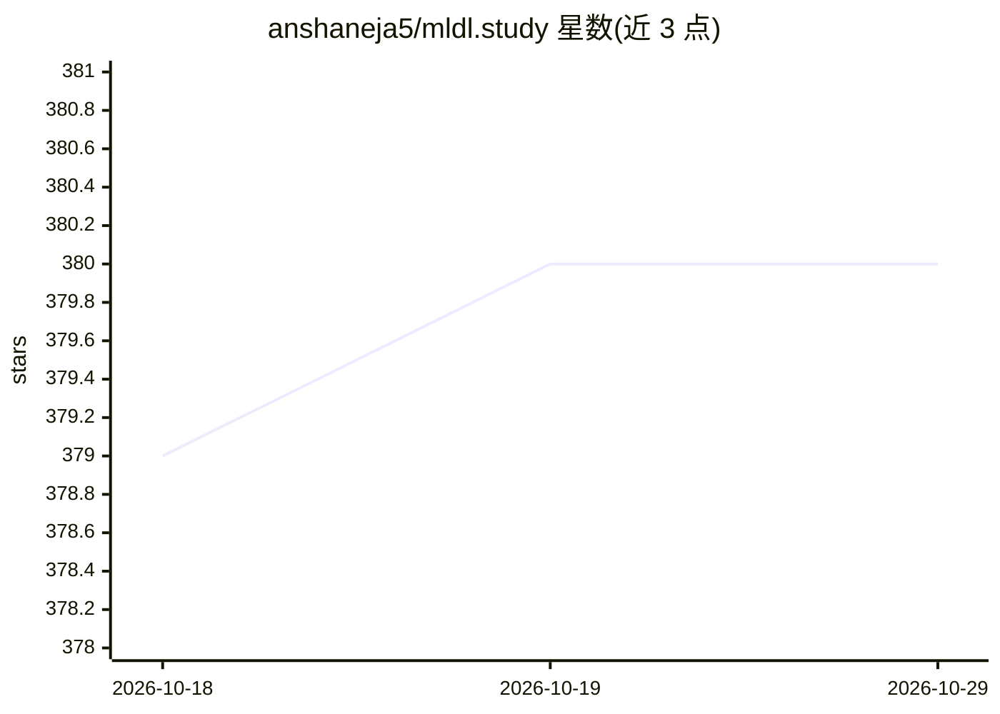

# anshaneja5/mldl.study

⭐ 380 · JavaScript · MIT · 推送 2026-08-21 · [GitHub](https://github.com/anshaneja5/mldl.study) · [官网](https://www.mldl.study/) · 个人维护

**面向学生的 ML/DL 学习路线图与资源策展平台**

免费的交互式 ML 与深度学习教育平台，为当前以印度受众为主的学习者提供策展路线图、视频教程、文章、PDF 与笔记。内容以 categorizedMLContent.js 与 categorizedDLContent.js 两个 JSON 风格文件组织，社区可通过 PR 按既有结构添加免费资源。基于 Node.js 前端项目运行（npm install 后 npm run dev），宣称有 10000+ 用户；未来计划扩展英文内容、Python 与生成式 AI 路线图。

## 筛选速览

| 维度 | 判定 | 备注 |
|---|---|---|
| AI 角色 | `ai-knowledge` | 知识聚合/清单类 |
| 许可风险 | `permissive` | MIT |
| 部署形态 | `library` | 以包/库形式分发 |
| 模型依赖 | — | README 未给出锁定关系 |
| 硬件要求 | — | 无带数字的原话,不猜 |
| 安装摩擦 | `low` | 无编译、无系统依赖或容器化 |
| 成熟度 | — | 结构信号不足 |

## 能力要点

- ML/DL 交互式路线图与分类资源（视频/文章/PDF/笔记）
- 内容以 JSON 风格文件组织，支持社区 PR 贡献
- 宣称社区用户 10000+

## 适用场景

- 按路线图系统学习机器学习与深度学习
- 按主题查找免费视频、文章与笔记资源
- 为 ML/DL 教学整理可共享的资料清单

## 场景标签

`教程课程` `精选清单` · 领域:学习与行业

## 证据(README 行号)

> L3: **MLDL.Study** is a free and interactive learning platform designed to simplify Machine Learning (ML) and Deep Learn
> L8: - **Diverse Resources**: Video tutorials, articles, PDFs, and notes curated for each topic

## 星数曲线

2026-10-18 379 → 2026-10-29 380（+1）

---
*卡片 v1 · prompt 1.4 · 生成 2026-10-21 · 置信度 high · 依据 README sha `1688a56e16cf` · [字段定义](../../DATASET.md)*
