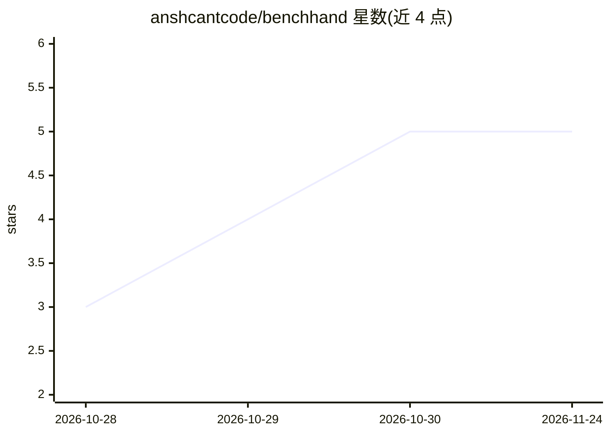

# anshcantcode/benchhand

⭐ 5 · Rust · Apache-2.0 · 推送 2026-11-17 · [GitHub](https://github.com/anshcantcode/benchhand) · 个人维护

**给个人用户在桌面端管理 AI 队友、模型与可审查操作的工作区**

基于 Tauri 与 Rust 的桌面工作区，把模型、任务与工具集中在一处：可创建不同角色与指令的队友，为每个队友分配独立模型连接，任务可在后台运行、定时执行或在队友间交接。核心机制是审批队列——写文件、Slack 消息、GitHub issue、MCP 工具调用等操作需人工批准、拒绝或编辑。提供 Windows/Linux 安装包与终端界面 benchhand-terminal。依赖外部模型服务，本地存储不加密，导入的 MCP 工具不受沙箱隔离。

## 筛选速览

| 维度 | 判定 | 备注 |
|---|---|---|
| AI 角色 | `ai-ecosystem` | LLM/agent 周边工具 |
| 许可风险 | `permissive` | Apache-2.0 |
| 部署形态 | `library` | 以包/库形式分发 |
| 模型依赖 | local-ok | 支持本地模型 |
| 硬件要求 | — | 无带数字的原话,不猜 |
| 安装摩擦 | `low` | 无编译、无系统依赖或容器化 |
| 成熟度 | `idea` | |

## 能力要点

- 队友化任务系统：角色/指令/定时/后台执行/任务交接
- 审批队列支持在执行前审查、编辑或拒绝动作
- 多连接方式：已登录 CLI、本地服务器、OpenAI 兼容 API、Anthropic Messages API
- MCP 服务器市场，支持 HTTP/stdio 配置导入与托管 npm 安装

## 适用场景

- 让 AI 队友处理文件夹中的研究或整理任务并逐步跟进
- 对 AI 写文件、发 Slack 消息等敏感操作逐一审批
- 通过 Ollama 或 LM Studio 在本地运行模型以保持数据不出本机

## 场景标签

`AI 助手` `工作流自动化` · 领域:效率与自动化

## 证据(README 行号)

> L19: Benchhand brings models, tasks and tools into one desktop workspace. Create teammates with different roles and inst
> L21: - **Choose your models.** Connect an existing signed-in CLI, a local server such as Ollama or LM Studio, an OpenAI-

## 星数曲线

2026-10-28 3 → 2026-11-24 5（+2）

---
*卡片 v1 · prompt 1.4 · 生成 2026-11-21 · 置信度 high · 依据 README sha `77131b73b50d` · [字段定义](../../DATASET.md)*
