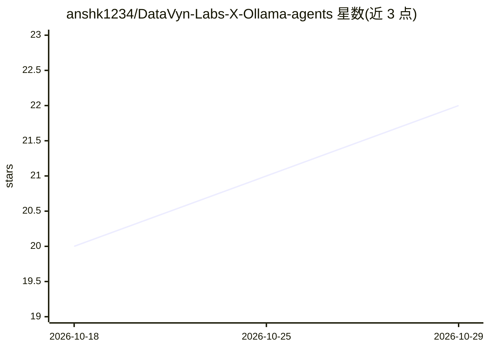

# anshk1234/DataVyn-Labs-X-Ollama-agents

⭐ 22 · Python · MIT · 推送 2026-04-07 · [GitHub](https://github.com/anshk1234/DataVyn-Labs-X-Ollama-agents) · [官网](https://datavyn-labs-x-ollama-agents.streamlit.app/) · 组织维护

**基于 Ollama 云端模型的 Streamlit 聊天界面**

DataVyn Labs 开发的 Streamlit Web 聊天应用，通过 Ollama 云端 API（ollama.com/api/chat）访问 19 个已验证的云端模型（OpenAI GPT-OSS、DeepSeek、Qwen、Gemini、Mistral、Kimi、GLM、MiniMax 等）。功能包括逐 token 流式输出、文件上传（txt/pdf/json/py/csv，截断至 4000 字符）、语音输入自动转文字、会话内存中的 API key 登录。运行方式为 git clone 后 pip 安装依赖并 streamlit run app.py，需自备 Ollama API key，另提供 Streamlit Cloud 在线演示。

## 筛选速览

| 维度 | 判定 | 备注 |
|---|---|---|
| AI 角色 | `ai-native` | 本体是模型或模型工具 |
| 许可风险 | `permissive` | MIT |
| 部署形态 | `library` | 以包/库形式分发 |
| 模型依赖 | local-ok | 支持本地模型 |
| 硬件要求 | — | 无带数字的原话,不猜 |
| 安装摩擦 | `low` | 无编译、无系统依赖或容器化 |
| 成熟度 | — | 结构信号不足 |

## 能力要点

- 接入 19 个 Ollama 云端模型（OpenAI/DeepSeek/Qwen/Gemini/Mistral 等）
- 逐 token 实时流式输出
- 文件上传与语音输入自动转文字
- API key 仅存于会话内存，不落盘

## 适用场景

- 在单一界面切换使用多家云端模型对话
- 上传文档或语音提问获取模型回答
- 无需本地部署模型即可快速搭建聊天应用

## 场景标签

`聊天机器人` · 领域:对话与助手

## 证据(README 行号)

> L3:  A clean, minimal AI chat interface powered by Ollama Cloud Models
> L112: - All model requests go through `https://ollama.com/api/chat`
> L43: streamlit run app.py

## 星数曲线

2026-10-18 20 → 2026-10-29 22（+2）

---
*卡片 v1 · prompt 1.4 · 生成 2026-10-28 · 置信度 mid · 依据 README sha `7bd84020d808` · [字段定义](../../DATASET.md)*
