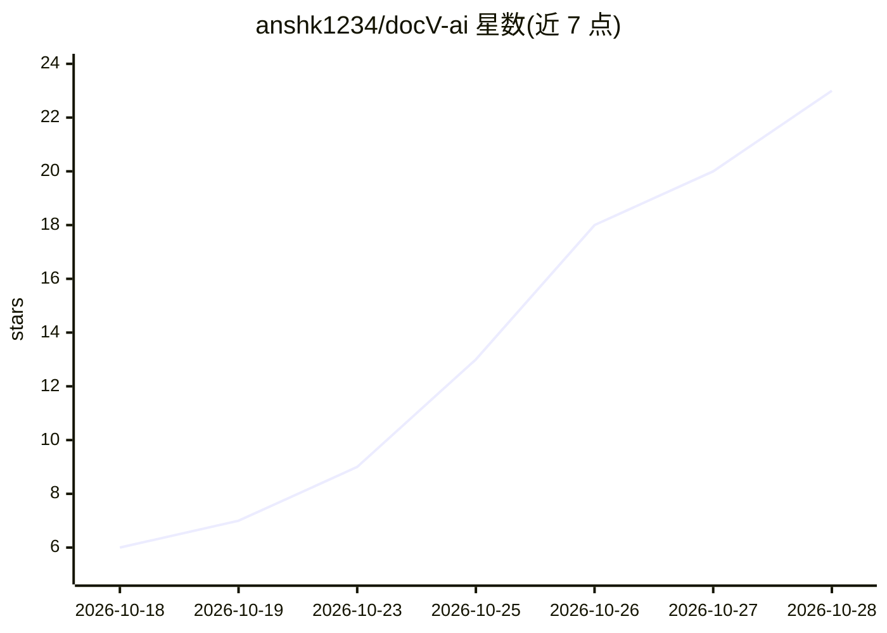

# anshk1234/docV-ai

⭐ 23 · TypeScript · MIT · 推送 2026-10-09 · [GitHub](https://github.com/anshk1234/docV-ai) · [官网](https://docv-ai.vercel.app) · 个人维护

**多文档调查问答引擎：跨文档矛盾检测与引用溯源**

docV.ai 是 ALGOTHON 26 参赛项目：摄取 PDF（pypdf）、图像（Gemini Vision）与文本/markdown，切分为 400 词带页码标签的分块并用 BM25Okapi 检索，生成带逐字引用的 Markdown 回答；对跨文档矛盾给出严重度评级，输出置信度分数与不确定性说明，冲突检测只在不同文件间触发以避免同文档误报。采用 FastAPI 后端 + Next.js 前端，依赖 Google Gemini API（含 key 轮换与模型降级）。限制：内存索引重启即重置、单轮查询、BM25 依赖关键词重叠。

## 筛选速览

| 维度 | 判定 | 备注 |
|---|---|---|
| AI 角色 | `ai-native` | 本体是模型或模型工具 |
| 许可风险 | `permissive` | MIT |
| 部署形态 | `library` | 以包/库形式分发 |
| 模型依赖 | — | README 未给出锁定关系 |
| 硬件要求 | — | 无带数字的原话,不猜 |
| 安装摩擦 | `low` | 无编译、无系统依赖或容器化 |
| 成熟度 | — | 结构信号不足 |

## 能力要点

- 跨文档矛盾检测（claim 对比 + 严重度评级）
- 逐字引用返回文档名、页码与原句片段
- BM25 页感知分块检索（400 词、50 词重叠）
- API key 轮换与分级模型降级机制

## 适用场景

- 核查合同、附件与发票之间的金额/期限矛盾
- 对多份文档提问并要求可验证的出处引用
- 替代简单摘要工具，获得带不确定性说明的回答

## 场景标签

`文档问答` · 领域:知识与检索

## 证据(README 行号)

> L20: Information in organizations is frequently dispersed across digital PDFs, scanned documents, and text files that ma
> L28: |Natural-language Q&A|Generates structured markdown answers strictly grounded in retrieved passages.|
> L31: |Uncertainty handling|Outputs confidence score (0-100), uncertainty level, and explicit factor explanations.|

## 星数曲线

2026-10-18 6 → 2026-10-28 23（+17）

---
*卡片 v1 · prompt 1.4 · 生成 2026-10-28 · 置信度 mid · 依据 README sha `e4a1cd04988b` · [字段定义](../../DATASET.md)*
