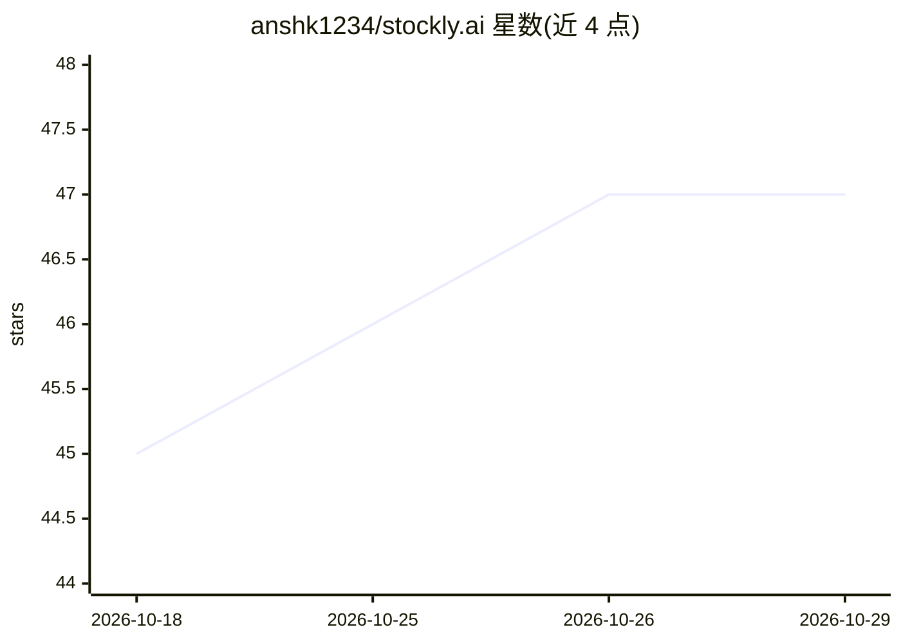

# anshk1234/stockly.ai

⭐ 47 · Python · Apache-2.0 · 推送 2026-10-27 · [GitHub](https://github.com/anshk1234/stockly.ai) · [官网](https://stockly-ai.streamlit.app) · 个人维护

**面向散户的对话式股票分析 Web 应用**

基于 Streamlit 的对话式股票分析应用：用户用自然语言提问任意股票，通过 Ollama 云端模型（流式输出）生成数据支撑的回答，同时展示实时行情指标（价格/市值/P/E/EPS 等，来自 yfinance）、Plotly K 线图与最新新闻标题。支持自动识别提问中的股票代码（100+ 热门标的）、快捷侧栏查询。运行需 Python 3.9+ 与 Ollama API key，可部署至 Streamlit Community Cloud 或 Docker。声明仅供信息与教育用途，不构成投资建议。

## 筛选速览

| 维度 | 判定 | 备注 |
|---|---|---|
| AI 角色 | `ai-native` | 本体是模型或模型工具 |
| 许可风险 | `permissive` | Apache-2.0 |
| 部署形态 | `self-host` | docker 或自建部署 |
| 模型依赖 | local-ok | 支持本地模型 |
| 硬件要求 | — | 无带数字的原话,不猜 |
| 安装摩擦 | `low` | 无编译、无系统依赖或容器化 |
| 成熟度 | — | 结构信号不足 |

## 能力要点

- Ollama 云端模型驱动的流式对话问答
- yfinance 实时指标 + Plotly 交互式 K 线图（6 种时间范围）
- 自动识别聊天中提到的股票代码（100+ 标的）
- 股票数据 5 小时 TTL 缓存减少 API 调用

## 适用场景

- 用自然语言询问某只股票的分析并看图
- 比较多只股票或查询最新相关新闻
- 在侧栏快速输入代码查看行情与 K 线

## 场景标签

`金融量化` `数据分析` · 领域:效率与自动化

## 证据(README 行号)

> L7: Stockly.AI is a conversational stock analysis web app. Users can ask natural-language questions about any stock and 
> L11: - **AI Chat Interface** — Conversational Q&A powered by Ollama cloud models (streaming responses)

## 星数曲线

2026-10-18 45 → 2026-10-29 47（+2）

---
*卡片 v1 · prompt 1.4 · 生成 2026-10-25 · 置信度 high · 依据 README sha `b9745d2182b0` · [字段定义](../../DATASET.md)*
