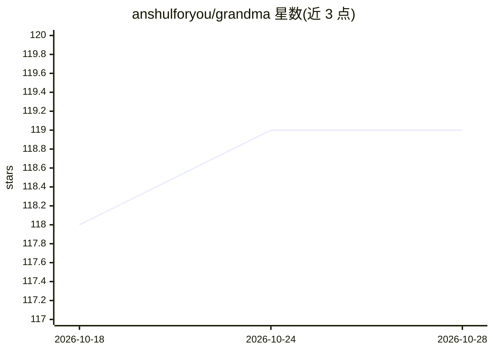

# anshulforyou/grandma

⭐ 119 · Shell · MIT · 推送 2026-10-15 · [GitHub](https://github.com/anshulforyou/grandma) · 个人维护

**Claude Code 的持久记忆层：按上下文分离的 markdown 记忆**

围绕 Claude Code CLI 的记忆管理工具：将记忆以纯 markdown 存储在用户自己的 git 仓库（默认 ~/.grandma），按 'sweater'（上下文，如某客户、某项目）隔离加载，含 global、sweater、项目 CLAUDE.md 三层。会话中被动学习并把写入呈现为未提交 diff 供 git diff 审查；支持按 sweater 绑定 MCP 服务器（凭据不落盘，存环境变量引用）；提供 search、analysis、update 等 CLI 命令。要求 Claude Code、git、jq、python3，macOS/Linux（Windows 走 WSL）。

## 筛选速览

| 维度 | 判定 | 备注 |
|---|---|---|
| AI 角色 | `ai-ecosystem` | LLM/agent 周边工具 |
| 许可风险 | `permissive` | MIT |
| 部署形态 | `None` |  |
| 模型依赖 | — | README 未给出锁定关系 |
| 硬件要求 | — | 无带数字的原话,不猜 |
| 安装摩擦 | `low` | 无编译、无系统依赖或容器化 |
| 成熟度 | — | 结构信号不足 |

## 能力要点

- 记忆以纯 markdown 存于用户自有 git 仓库，写入均为未提交 diff 可审查
- 三层记忆（global/sweater/项目 CLAUDE.md）按上下文隔离加载，隔离由测试强制
- MCP 服务器可按 sweater 绑定，令牌仅存环境变量引用不落盘
- 无服务器、无遥测的 bash CLI，grandma update 走 git fast-forward

## 适用场景

- 让 Claude Code 跨会话记住我的技术栈与偏好，无需每次重述
- 把不同客户/项目的记忆相互隔离，避免串味
- 回顾并审查 AI 学到的记忆（通过 git diff）

## 场景标签

`Agent 记忆` · 领域:Agent 开发

## 证据(README 行号)

> L4:  A memory layer for Claude Code that learns as you work.
> L113: - `grandma acme` assembles global + acme memory and launches Claude Code with it.
> L163: Memory lives in `GRANDMA_HOME` (default `~/.grandma`), a git repo that belongs to you. The engine never stores you

## 星数曲线

2026-10-18 118 → 2026-10-28 119（+1）

---
*卡片 v1 · prompt 1.4 · 生成 2026-10-23 · 置信度 high · 依据 README sha `aa916a2e0275` · [字段定义](../../DATASET.md)*
