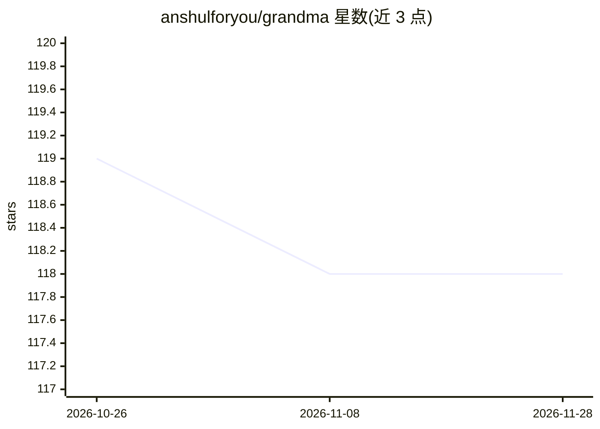

# anshulforyou/grandma

⭐ 118 · Shell · MIT · 推送 2026-11-26 · [GitHub](https://github.com/anshulforyou/grandma) · 个人维护

**为 Claude Code 提供按上下文隔离的持久记忆层**

一个面向 Claude Code 的 CLI 记忆工具：以 git 仓库中的纯 markdown 文件存储记忆，按「sweater」（独立上下文，如客户、项目）分隔，含 global/、sweater/、项目 CLAUDE.md 三层结构，不同 sweater 间记忆互相隔离并有测试强制。支持会话中被动学习写入、跨会话历史分析、只读搜索（ripgrep/grep）、按 sweater 绑定 MCP 服务器及 OAuth 凭据引导。依赖 Claude Code、git、jq、python3，运行于 macOS/Linux（Windows 经 WSL），无服务器、无遥测，更新为 git fast-forward。

## 筛选速览

| 维度 | 判定 | 备注 |
|---|---|---|
| AI 角色 | `ai-ecosystem` | LLM/agent 周边工具 |
| 许可风险 | `permissive` | MIT |
| 部署形态 | `None` |  |
| 模型依赖 | — | README 未给出锁定关系 |
| 硬件要求 | — | 无带数字的原话,不猜 |
| 安装摩擦 | `low` | 无编译、无系统依赖或容器化 |
| 成熟度 | — | 结构信号不足 |

## 能力要点

- 按 sweater 隔离的记忆，全局/上下文/项目三层结构
- 会话中被动学习，写入以未提交 diff 形式供 git diff 审查
- 跨会话聊天历史分析与记忆生成（grandma 命令）
- 按 sweater 绑定 MCP 服务器，凭据存引用不存明文

## 适用场景

- 在不同客户/项目间切换时保持各自约定与偏好记忆
- 新会话无需重新解释技术栈与工作规范
- 让 AI 分析数周聊天记录并总结为写作风格等长期记忆

## 场景标签

`Agent 记忆` · 领域:Agent 开发

## 证据(README 行号)

> L4:  A memory layer for Claude Code that learns as you work.
> L113: - `grandma acme` assembles global + acme memory and launches Claude Code with it.
> L55: Requirements: Claude Code, git, jq, python3. macOS or Linux (Windows via WSL). `grandma doctor` checks everything a

## 星数曲线

2026-10-26 119 → 2026-11-28 118（-1）

---
*卡片 v1 · prompt 1.4 · 生成 2026-11-28 · 置信度 high · 依据 README sha `8f6f4ef01491` · [字段定义](../../DATASET.md)*
