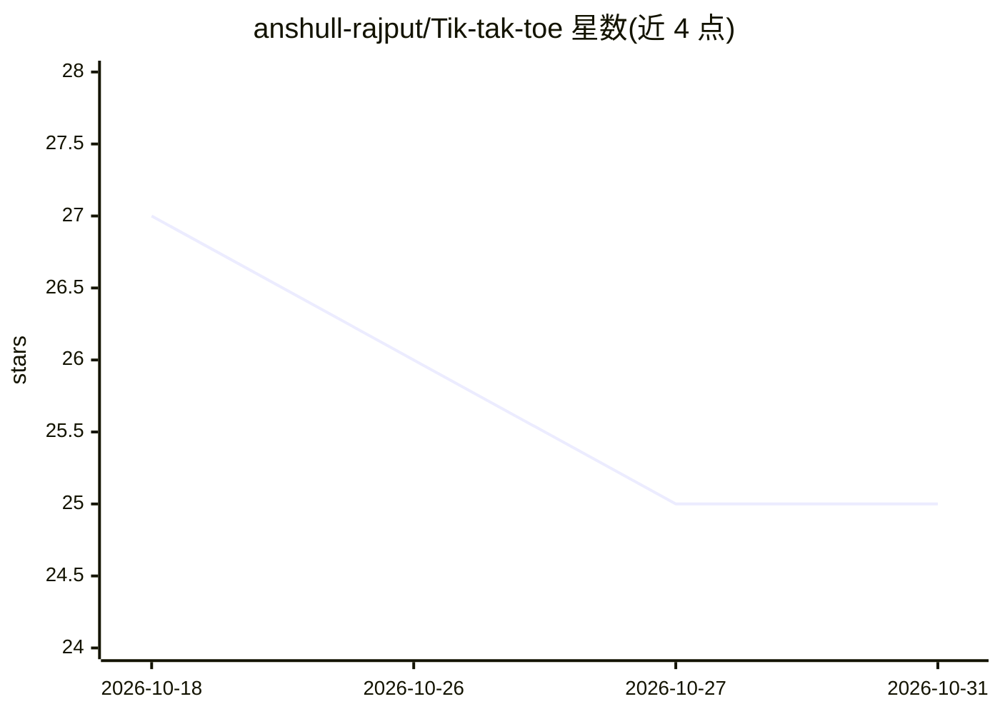

# anshull-rajput/Tik-tak-toe

⭐ 25 · C++ · 推送 2026-09-02 · [GitHub](https://github.com/anshull-rajput/Tik-tak-toe) · [官网](https://ai-healthvault-2aqxa4mwhvxgo2auwaet36.streamlit.app/) · 个人维护

**C++ 控制台井字棋：双人对战与 Minimax AI 对手**

C++ 编写的井字棋控制台游戏，包含两个源文件：tictactoe.cpp 为双人本地对战版本，tictactoe_ai.cpp 为人机对战版本，AI 对手采用 Minimax 算法决策。功能含输入校验与简单控制台界面，README 同时列出所演示的编程概念（数组、循环、函数、Minimax 等），通过 g++ 手动编译运行，无构建系统或安装脚本。

## 筛选速览

| 维度 | 判定 | 备注 |
|---|---|---|
| AI 角色 | `ai-enhanced` | 去掉 AI 部分产品仍成立 |
| 许可风险 | `none` | — |
| 部署形态 | `None` |  |
| 模型依赖 | — | README 未给出锁定关系 |
| 硬件要求 | — | 无带数字的原话,不猜 |
| 安装摩擦 | `medium` | 含编译或系统依赖之一 |
| 成熟度 | — | 结构信号不足 |

## 能力要点

- 双人本地对战与人机对战两种模式
- Minimax 算法实现 AI 对手
- 输入校验与控制台界面

## 适用场景

- 在终端与朋友进行井字棋对战
- 与 Minimax AI 对手下棋
- 学习 Minimax 算法与 C++ 基础语法的示例项目

## 场景标签

`教程课程` · 领域:学习与行业

## 证据(README 行号)

> L3: A simple Tic-Tac-Toe game built in **C++**. It includes a 2-player mode and an optional AI opponent using the **Mini
> L11: - Minimax-based AI
> L18: |`tictactoe_ai.cpp`|Player vs AI version|

## 星数曲线

2026-10-18 27 → 2026-10-31 25（-2）

---
*卡片 v1 · prompt 1.4 · 生成 2026-10-26 · 置信度 high · 依据 README sha `278adf628422` · [字段定义](../../DATASET.md)*
