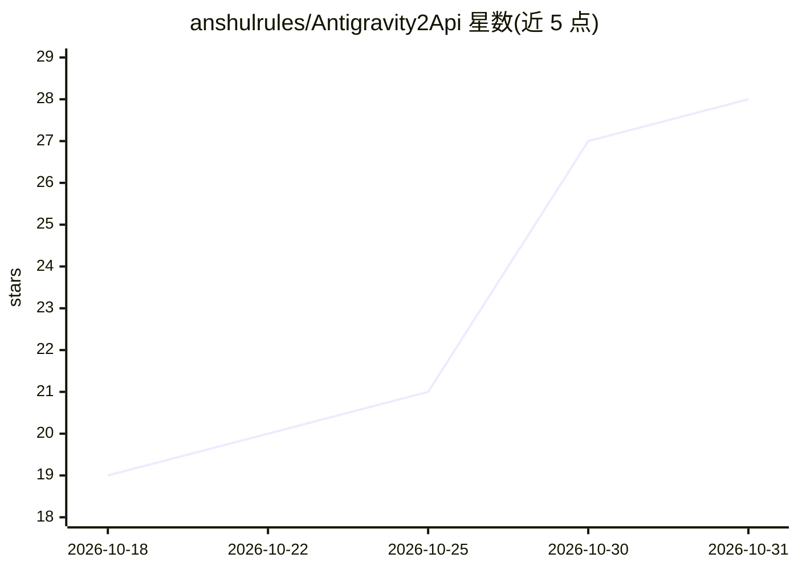

# anshulrules/Antigravity2Api

⭐ 28 · JavaScript · Apache-2.0 · 推送 2026-10-12 · [GitHub](https://github.com/anshulrules/Antigravity2Api) · [官网](https://anshulrules.github.io) · 个人维护

**将 Antigravity 转换为标准 Claude/Gemini API 的接口转换工具**

面向使用 Claude 与 Gemini API 的开发者：把 Antigravity 转换为标准 API 接口，支持结构化输出与工具调用（Claude tool calls 与 Gemini function calls 可互换使用），并传输 thought signatures 以避免常见错误。针对 MCP 使用中的模型过渡问题提供规避方案：请求包含 mcp__* 工具时提示避免直接 MCP 调用。通过 GitHub Releases 下载对应操作系统的可执行文件运行，要求 4GB 内存与 200MB 磁盘空间。

## 筛选速览

| 维度 | 判定 | 备注 |
|---|---|---|
| AI 角色 | `ai-ecosystem` | LLM/agent 周边工具 |
| 许可风险 | `permissive` | Apache-2.0 |
| 部署形态 | `desktop` | 安装包/桌面程序 |
| 模型依赖 | — | README 未给出锁定关系 |
| 硬件要求 | — | 无带数字的原话,不猜 |
| 安装摩擦 | `low` | 无编译、无系统依赖或容器化 |
| 成熟度 | — | 结构信号不足 |

## 能力要点

- 将 Antigravity 转换为标准 Claude 与 Gemini API 接口
- Claude tool calls 与 Gemini function calls 可互换使用
- 传输 thought signatures 避免常见数据传输错误
- 针对 MCP 模型过渡问题提供规避提示

## 适用场景

- 以标准 Claude/Gemini API 形式调用 Antigravity
- 在需要结构化输出与函数调用的工作流中接入
- 处理 MCP 工具调用时的兼容问题

## 场景标签

`模型网关` · 领域:Agent 开发

## 证据(README 行号)

> L7: Antigravity2Api allows you to interact with advanced APIs like Claude and Gemini seamlessly. It converts Antigravity
> L30: - **Tool Calls**: Provides flexibility to operate Claude tool calls and Gemini function calls interchangeably, maki

## 星数曲线

2026-10-18 19 → 2026-10-31 28（+9）

---
*卡片 v1 · prompt 1.4 · 生成 2026-10-28 · 置信度 mid · 依据 README sha `a6327fd59fd1` · [字段定义](../../DATASET.md)*
