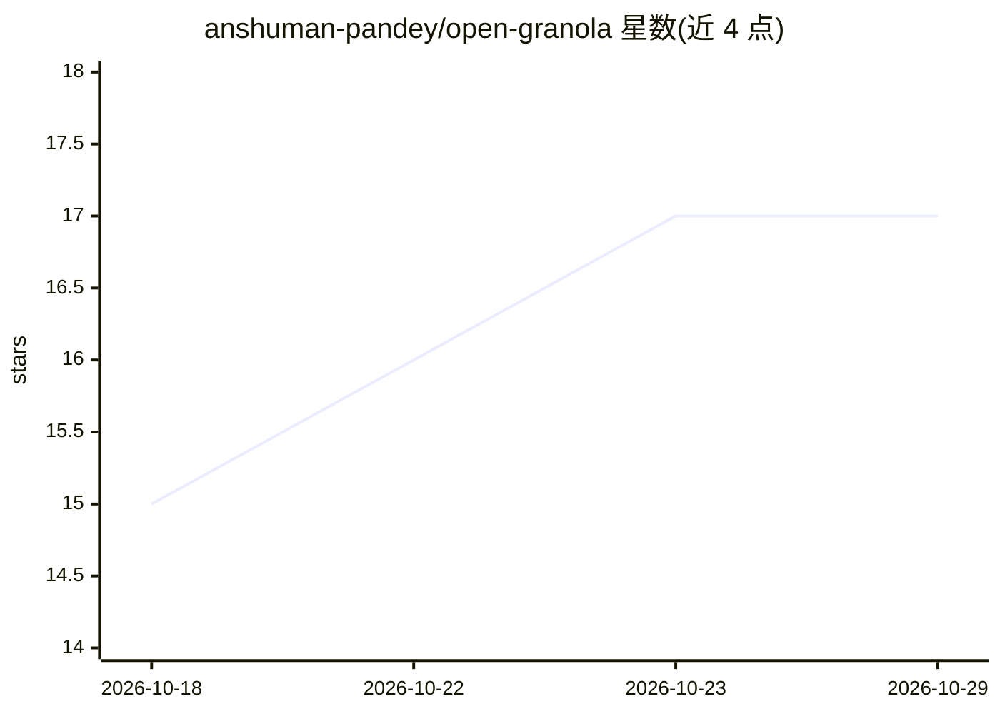

# anshuman-pandey/open-granola

⭐ 17 · TypeScript · Apache-2.0 · 推送 2026-10-22 · [GitHub](https://github.com/anshuman-pandey/open-granola) · [官网](https://github.com/anshuman-pandey/open-granola) · 个人维护

**本地优先的开源会议笔记桌面应用：本地 Whisper 转写加可选拆要模型**

基于 Tauri/React/Rust 的桌面会议笔记本（开发预览版）：录制麦克风音频，用本地 whisper.cpp 转写生成带时间戳的逐字稿，再由内置本地 Qwen、LM Studio、OpenAI API、Claude API、OpenAI 兼容端点或 ChatGPT 登录生成笔记、行动项与承诺；会议库存于本地 SQLite，支持失败后重试摘要、关键词搜索与 Markdown 导出。限制：系统音频采集未实现，本地 Whisper 为录制必需且模型需手动安装，无预编译安装包承诺，面向需要本地优先隐私方案的用户。

## 筛选速览

| 维度 | 判定 | 备注 |
|---|---|---|
| AI 角色 | `ai-native` | 本体是模型或模型工具 |
| 许可风险 | `permissive` | Apache-2.0 |
| 部署形态 | `None` |  |
| 模型依赖 | local-ok | 支持本地模型 |
| 硬件要求 | — | 无带数字的原话,不猜 |
| 安装摩擦 | `low` | 无编译、无系统依赖或容器化 |
| 成熟度 | `idea` | |

## 能力要点

- 本地 whisper.cpp 麦克风转写与实时逐字稿
- 多种摘要通道：内置本地 Qwen、LM Studio、OpenAI/Claude API、OpenAI 兼容端点（如本地 Ollama）
- 转写先于摘要保存，失败可重试而不需重新录制
- 本地 SQLite 会议库：关键词搜索、行动项、Markdown 导出与保留控制

## 适用场景

- 开会时录制麦克风并生成带行动项的会议笔记
- 在本地模型上完成转写与摘要，避免会议内容上传云端
- 会后检索本地会议库并复盘笔记生成所用的模型与状态

## 场景标签

`语音识别` `知识库管理` · 领域:知识与检索

## 证据(README 行号)

> L16: **Development preview.** Open Granola records your microphone, transcribes with local Whisper, and turns the transc
> L22: - **Microphone transcription:** local `whisper.cpp`, timestamped transcript segments and a visible live transcript.

## 星数曲线

2026-10-18 15 → 2026-10-29 17（+2）

---
*卡片 v1 · prompt 1.4 · 生成 2026-10-29 · 置信度 high · 依据 README sha `e10aa892c55a` · [字段定义](../../DATASET.md)*
