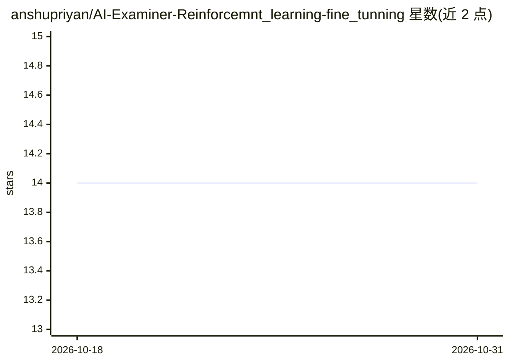

# anshupriyan/AI-Examiner-Reinforcemnt_learning-fine_tunning

⭐ 14 · Python · MIT · 推送 2026-05-22 · [GitHub](https://github.com/anshupriyan/AI-Examiner-Reinforcemnt_learning-fine_tunning) · 个人维护

**用 SFT+GRPO 训练出题 Agent 的对抗训练流水线**

面向 Python 内存管理等概念的训练代码库：将基座模型经 SFT（JSON 格式对齐）与 GRPO（可验证奖励优化题目复杂度）两阶段训练为高难度出题 Agent（Q-Agent），另有解题 Agent（A-Agent）与两者对战的验证环境。奖励由 rewards.py 的解析脚本按格式、长度、技术关键词判定；集成 Unsloth 以降低显存占用。需 Python 3.10+ 与 NVIDIA GPU，Windows 用户可能需关闭 torch.compile 或安装 VS Build Tools。

## 筛选速览

| 维度 | 判定 | 备注 |
|---|---|---|
| AI 角色 | `ai-ecosystem` | LLM/agent 周边工具 |
| 许可风险 | `permissive` | MIT |
| 部署形态 | `library` | 以包/库形式分发 |
| 模型依赖 | — | README 未给出锁定关系 |
| 硬件要求 | — | 无带数字的原话,不猜 |
| 安装摩擦 | `low` | 无编译、无系统依赖或容器化 |
| 成熟度 | — | 结构信号不足 |

## 能力要点

- 两阶段训练：SFT 格式对齐 + GRPO 可验证奖励优化
- Attacker/Defender 双 Agent 对抗框架与对战验证界面
- 关键词/结构化的可验证奖励流水线（rewards.py）
- Unsloth 集成，支持消费级笔记本 GPU（RTX 5050+）训练

## 适用场景

- 训练能生成高难度 Python 选择题的出题模型
- 学习 SFT+GRPO 双阶段 RL 训练流水线的实现
- 通过双 Agent 对战验证训练效果

## 场景标签

`微调` `强化学习` · 领域:训练与推理

## 证据(README 行号)

> L7: This repository features a specialized dual-agent training pipeline designed to master complex Python concepts. By c
> L16: * **Two-Stage Q-Agent Training:**

## 星数曲线

2026-10-18 14 → 2026-10-31 14（+0）

---
*卡片 v1 · prompt 1.4 · 生成 2026-10-31 · 置信度 high · 依据 README sha `46b943e765ad` · [字段定义](../../DATASET.md)*
