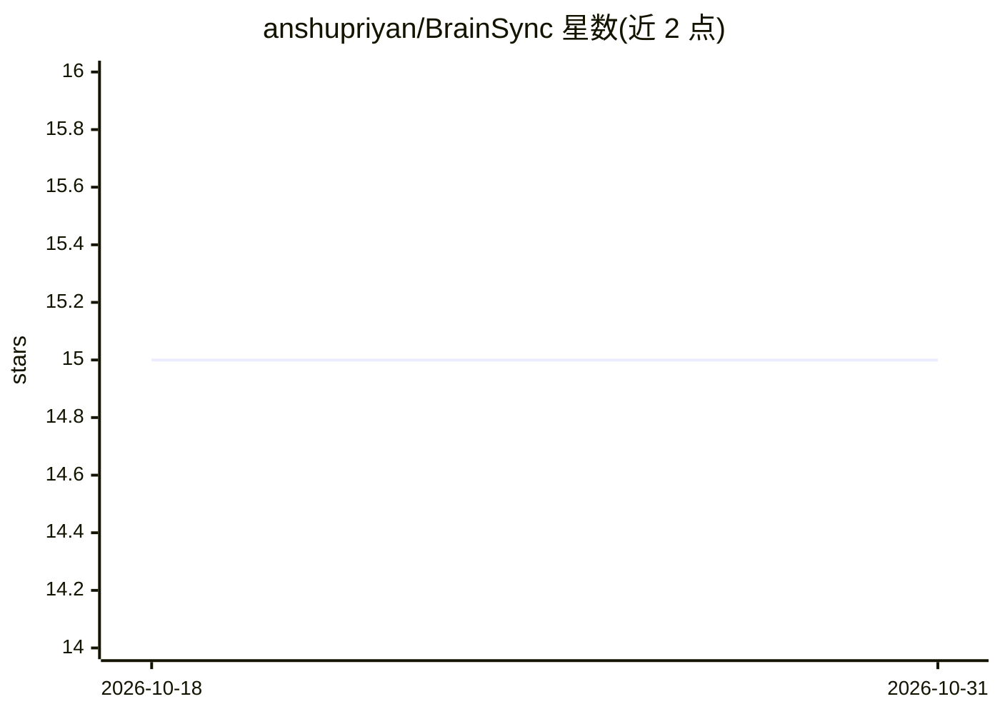

# anshupriyan/BrainSync

⭐ 15 · Python · MIT · 推送 2026-05-22 · [GitHub](https://github.com/anshupriyan/BrainSync) · 个人维护

**把 ChatGPT/Claude 导出同步进 Obsidian 并本地打标签的工具**

面向 Obsidian 用户的对话导出管理工具：监控文件夹中的 ChatGPT/Claude 导出 ZIP，自动识别格式解析，调用用户本机运行的 OpenAI 兼容端点 LLM（LM Studio/Ollama 等）生成标签、摘要与分类，生成带 frontmatter 和 wikilinks 的 Markdown 笔记，并按标签/分类计分交叉链接相关对话。LLM 离线时先保存未打标签笔记并入队，上线后自动补处理；通过会话 ID 与消息数去重。以 Python 脚本形式从源码运行，需 Python 3.8+ 与本机 LLM 服务器。

## 筛选速览

| 维度 | 判定 | 备注 |
|---|---|---|
| AI 角色 | `ai-enhanced` | 去掉 AI 部分产品仍成立 |
| 许可风险 | `permissive` | MIT |
| 部署形态 | `desktop` | 安装包/桌面程序 |
| 模型依赖 | local-ok | 支持本地模型 |
| 硬件要求 | — | 无带数字的原话,不猜 |
| 安装摩擦 | `low` | 无编译、无系统依赖或容器化 |
| 成熟度 | — | 结构信号不足 |

## 能力要点

- 自动识别 Claude/ChatGPT 导出格式并解析为 Markdown
- 本地 LLM 生成标签、摘要与分类，无云 API
- 按标签与分类计分自动交叉链接相关对话
- LLM 离线时入队、上线后自动补打标签；按会话 ID 去重

## 适用场景

- 把 ChatGPT/Claude 的历史对话沉淀为 Obsidian 知识库
- 在本地离线环境为对话自动打标签和生成摘要
- 通过 Dataview/Graph View 检索和浏览对话笔记

## 场景标签

`知识库管理` · 领域:知识与检索

## 证据(README 行号)

> L4: **Sync, tag, and cross-link your ChatGPT & Claude conversation exports into an Obsidian vault — powered entirely by 
> L13: 2. **Sends a snippet** to your **local LLM** to generate tags, a summary, and a category.
> L25: |**A local LLM server**|Any server with an OpenAI-compatible `/v1/chat/completions` endpoint (LM Studio, Ollama, te

## 星数曲线

2026-10-18 15 → 2026-10-31 15（+0）

---
*卡片 v1 · prompt 1.4 · 生成 2026-10-30 · 置信度 high · 依据 README sha `ffd950bab640` · [字段定义](../../DATASET.md)*
