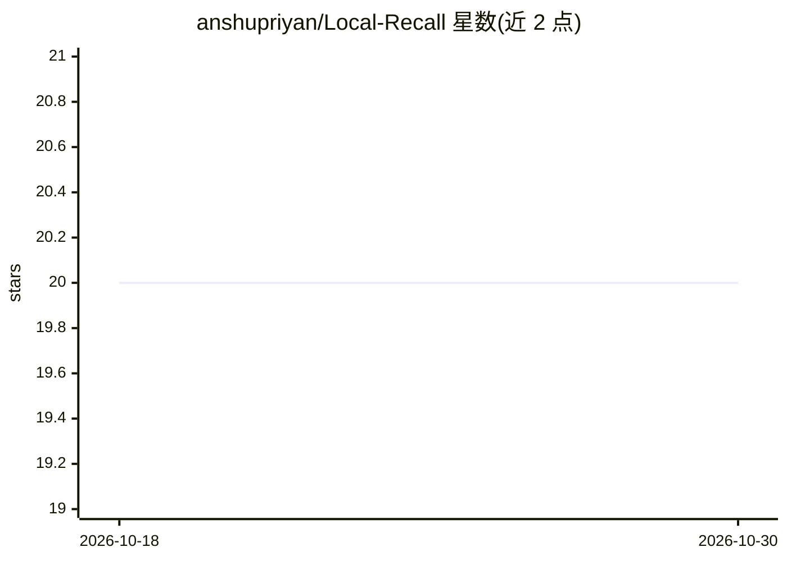

# anshupriyan/Local-Recall

⭐ 20 · Python · MIT · 推送 2026-07-16 · [GitHub](https://github.com/anshupriyan/Local-Recall) · 个人维护

**本地屏幕记录+OCR+语义搜索工具，数据不出本机**

Windows 平台的本地屏幕历史工具：每 5 秒截屏并做感知哈希去重，后台用 WinRT OCR 引擎提取文本，sentence-transformers 生成 384 维向量存入 sqlite-vec 虚拟表，支持亚 50ms 的 KNN 语义检索；对话问答通过 LM Studio 本地 OpenAI 兼容服务加载 Qwen 2.5-7B 做 RAG，附带 CLI 搜索、对话 CLI 与 Flask 网页浏览器界面。需 Windows 10/11、Python 虚拟环境与 LM Studio，自称 Windows Recall 的本地替代，项目处于早期原型阶段，API 与数据库结构可能变动。

## 筛选速览

| 维度 | 判定 | 备注 |
|---|---|---|
| AI 角色 | `ai-native` | 本体是模型或模型工具 |
| 许可风险 | `permissive` | MIT |
| 部署形态 | `library` | 以包/库形式分发 |
| 模型依赖 | — | README 未给出锁定关系 |
| 硬件要求 | — | 无带数字的原话,不猜 |
| 安装摩擦 | `low` | 无编译、无系统依赖或容器化 |
| 成熟度 | `idea` | |

## 能力要点

- 截屏→OCR→向量化的异步流水线，感知哈希去重跳过静态画面
- sqlite-vec 虚拟表本地 KNN 语义搜索（官方称亚 50ms）
- 接入 LM Studio 本地 LLM 做 RAG 对话式问答，答案附来源时间戳
- 提供 CLI 搜索、对话 CLI 与 Flask 网页浏览器三种使用界面

## 适用场景

- 回顾并语义搜索自己看过什么屏幕内容
- 就本机屏幕历史进行问答（如看过哪个视频）
- 在不上传数据的前提下留存可检索的屏幕活动历史

## 场景标签

`RAG` `语义搜索` `OCR` · 领域:知识与检索

## 证据(README 行号)

> L3: A 100% local, privacy-first alternative to Windows Recall — captures your screen, OCRs it, and lets you semantically
> L16: 5. **Retrieval-Augmented Generation (RAG)**: Integrates with a local LM Studio server running **Qwen 2.5-7B** to pr

## 星数曲线

2026-10-18 20 → 2026-10-30 20（+0）

---
*卡片 v1 · prompt 1.4 · 生成 2026-10-28 · 置信度 high · 依据 README sha `1609d5e5d4d8` · [字段定义](../../DATASET.md)*
