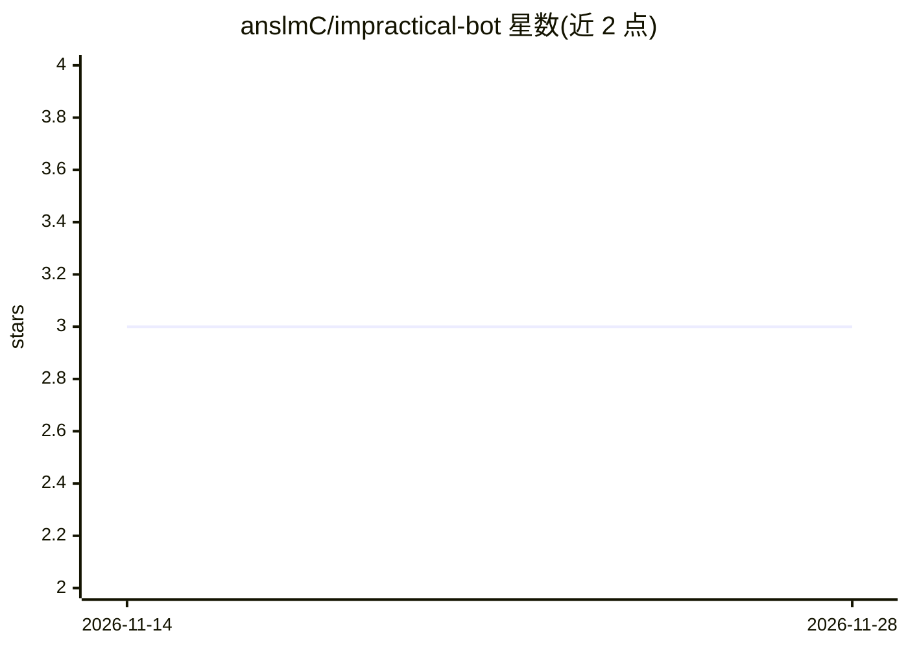

# anslmC/impractical-bot

⭐ 3 · TypeScript · MIT · 推送 2026-11-14 · [GitHub](https://github.com/anslmC/impractical-bot) · 个人维护

**监听 Messenger 会话并生成个性化回复的本地机器人**

Impractical Bot 是一个本地运行的 Node.js CLI 工具：通过 Playwright 驱动真实浏览器观察指定的 Facebook Messenger 会话，在用户被提及时自动回复，并可根据 quiet/balanced/talkative 三档性格自主参与对话。回复内容由 NVIDIA chat completions API 生成，支持默认或自定义人格，内置 Composer Slicer 长消息分片、终端仪表盘与调试视图。仅支持 Windows 平台与 Brave/Chrome/Edge 浏览器。

## 筛选速览

| 维度 | 判定 | 备注 |
|---|---|---|
| AI 角色 | `ai-native` | 本体是模型或模型工具 |
| 许可风险 | `permissive` | MIT |
| 部署形态 | `library` | 以包/库形式分发 |
| 模型依赖 | — | README 未给出锁定关系 |
| 硬件要求 | — | 无带数字的原话,不猜 |
| 安装摩擦 | `low` | 无编译、无系统依赖或容器化 |
| 成熟度 | — | 结构信号不足 |

## 能力要点

- 通过专用浏览器配置文件驱动真实浏览器观察 Messenger 会话
- 三档 temperament（quiet/balanced/talkative）控制自主发言行为
- 支持默认或自定义人格，回复经 NVIDIA chat completions API 生成
- Composer Slicer 按可配置上限拆分长回复

## 适用场景

- 在自己的 Messenger 群聊中部署一个可定制人格的机器人
- 让机器人被提及时自动回复或按性格主动参与聊天

## 场景标签

`浏览器自动化` `聊天机器人` · 领域:效率与自动化

## 证据(README 行号)

> L3: Impractical Bot is a local Node.js CLI that watches a Facebook Messenger conversation, replies when someone mentions
> L15: - Runs locally, apart from the NVIDIA API calls used to generate replies.

## 星数曲线

2026-11-14 3 → 2026-11-28 3（+0）

---
*卡片 v1 · prompt 1.4 · 生成 2026-11-22 · 置信度 high · 依据 README sha `c7a1f413a65a` · [字段定义](../../DATASET.md)*
