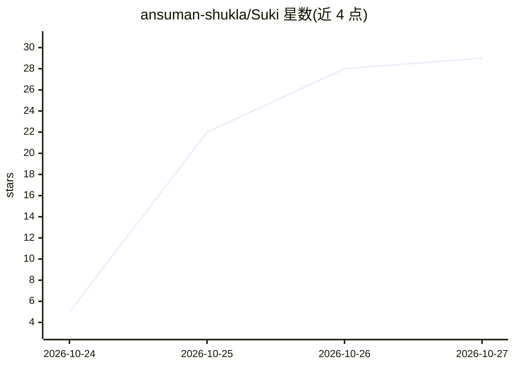

# ansuman-shukla/Suki

⭐ 29 · Swift · MIT · 推送 2026-10-22 · [GitHub](https://github.com/ansuman-shukla/Suki) · 个人维护

**macOS 全局语音听写工具，自带 API Key，支持多模型**

面向 Mac 用户的听写应用：按住 fn 键说话，将语音转录为文字输入到任意应用。支持 OpenAI、Groq、Gemini、Claude 等云模型及本地模型（BYOK，需自行粘贴 API key）。无账户与官方服务器，安装包约 25MB，macOS 13 及以上，Apple Silicon 与 Intel 均可运行。通过 Releases 页面下载 dmg 拖入 Applications 安装。

## 筛选速览

| 维度 | 判定 | 备注 |
|---|---|---|
| AI 角色 | `ai-native` | 本体是模型或模型工具 |
| 许可风险 | `permissive` | MIT |
| 部署形态 | `None` |  |
| 模型依赖 | locked-api |  |
| 硬件要求 | — | 无带数字的原话,不猜 |
| 安装摩擦 | `low` | 无编译、无系统依赖或容器化 |
| 成熟度 | — | 结构信号不足 |

## 能力要点

- 按住 fn 键在任意 Mac 应用内听写
- 支持 OpenAI/Groq/Gemini/Claude 及本地模型（BYOK）
- 无账户、无官方服务器，本地优先
- 体积约 25MB，macOS 13+，Apple Silicon 与 Intel

## 适用场景

- 在任意 Mac 应用中用语音输入文字
- 使用自己的 API key 或本地模型保护隐私
- 配合自定义词典与代码片段听写

## 场景标签

`语音识别` · 领域:感知与多模态

## 证据(README 行号)

> L3:  Suki: free, private dictation for every app on your Mac. Download for Mac, macOS 13 or later, Apple Silicon and Int
> L9:  Why Suki: tiny (about 20x smaller than Wispr Flow), free with no word limits, private with no account or Suki serve

## 星数曲线

2026-10-24 5 → 2026-10-27 29（+24）

---
*卡片 v1 · prompt 1.4 · 生成 2026-10-26 · 置信度 high · 依据 README sha `3a8a6a6699f6` · [字段定义](../../DATASET.md)*
