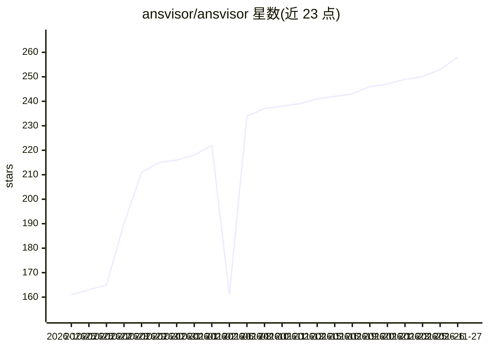

# ansvisor/ansvisor

⭐ 258 · TypeScript · MIT · 推送 2026-11-26 · [GitHub](https://github.com/ansvisor/ansvisor) · [官网](https://ansvisor.com) · 组织维护

**开源 agentic AI 搜索可见度执行平台：跟踪品牌在 AI 答案中的出现并生成修复动作**

面向企业与营销团队的 AI 搜索执行平台：跨 ChatGPT、Google AI Overviews、Gemini、Claude 等平台跟踪提示词、提及、引用、竞争对手与 AI 流量；Agent 将信号转为按 KPI 排序的行动清单并起草内容修复，用户审批后生效。依赖 Supabase 作为数据库/认证，需配置至少一个 AI Provider API key 及 Cloro 或 Anakin 之一来向 AI 平台发送查询。支持自托管（Node.js >= 20 + Yarn）或使用云服务，提供 MCP Server 供外部 agent 调用。

## 筛选速览

| 维度 | 判定 | 备注 |
|---|---|---|
| AI 角色 | `ai-enhanced` | 去掉 AI 部分产品仍成立 |
| 许可风险 | `permissive` | MIT |
| 部署形态 | `self-host` | docker 或自建部署 |
| 模型依赖 | — | README 未给出锁定关系 |
| 硬件要求 | — | 无带数字的原话,不猜 |
| 安装摩擦 | `low` | 无编译、无系统依赖或容器化 |
| 成熟度 | — | 结构信号不足 |

## 能力要点

- 跨 ChatGPT、Gemini、Google AI Overviews 等平台的品牌可见度、引用与竞争对手跟踪
- Action Center 将信号转为优先级动作，Agent 起草内容修复并等待审批
- Content Agent 按品牌事实与内容规则（禁用词、来源白名单）撰写页面
- 通过 MCP Server 将数据接入 AI 助手与 agent 工作流

## 适用场景

- 跟踪品牌在 AI 搜索答案中的提及、引用与情感倾向
- 让 agent 将可见度信号转化为内容优化任务并审批执行
- 对比自身与竞争对手在 AI 平台上的可见度份额
- 分析引用差距：哪些第三方域名引用竞品而非自己

## 场景标签

`数据分析` · 领域:效率与自动化

## 证据(README 行号)

> L14: Ansvisor is an **open-source, agentic AI Search Execution Platform**. It shows how your brand appears in AI answers
> L49: - **Action Center** — Turn signals across your workspace and connected data sources into prioritized actions and ta
> L144: |**AI Provider** (at least one)|Brand tracking across AI engines|OpenAI / Google Gemini / Anthropic|

## 星数曲线

2026-10-25 161 → 2026-11-27 258（+97）

---
*卡片 v1 · prompt 1.4 · 生成 2026-11-26 · 置信度 high · 依据 README sha `66bd55ed1c5d` · [字段定义](../../DATASET.md)*
