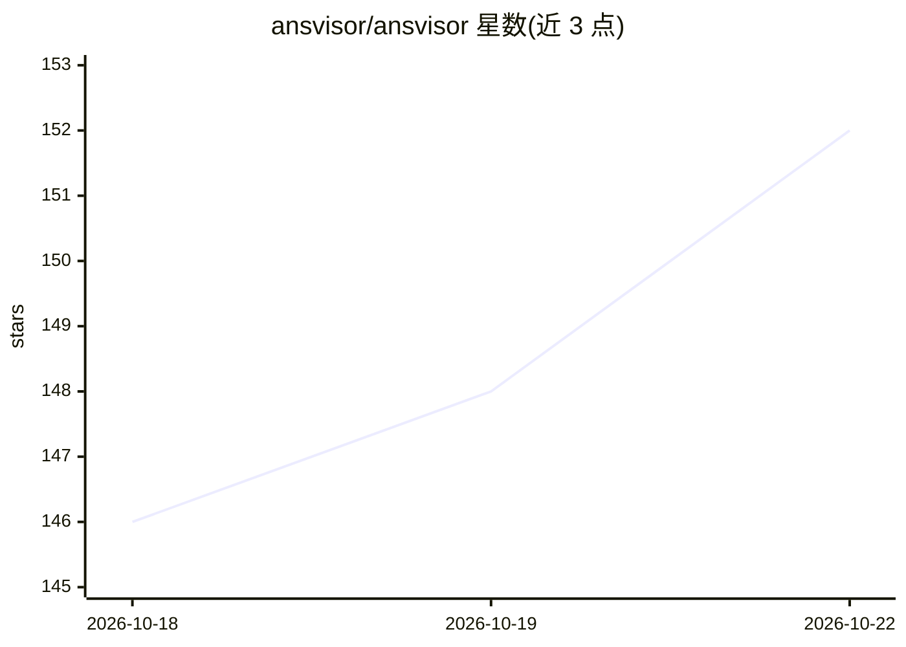

# ansvisor/ansvisor

⭐ 152 · TypeScript · MIT · 推送 2026-10-21 · [GitHub](https://github.com/ansvisor/ansvisor) · [官网](https://ansvisor.com) · 组织维护

**开源 AI 搜索可见性分析平台：帮品牌追踪与优化在 AI 搜索中的表现**

面向品牌与营销团队的开源 AI Search Intelligence 平台：追踪品牌在 ChatGPT、Google AI Overviews、Gemini、Claude、Perplexity、Copilot、Grok 等 AI 平台中的可见性、提示词、引用、竞品与 AI 流量，并把业务数据与传统搜索信号转化为优先级行动与任务。包含 Action Center、提示词监控、引用监控、竞品对标、站点审计、MCP Server 与对话式 AI 助手。自托管需 Node.js 20+、Supabase、至少一个 AI Provider 及 Cloro 抓取服务，支持 Docker Compose 部署，也可用托管云服务；MIT 许可。

## 筛选速览

| 维度 | 判定 | 备注 |
|---|---|---|
| AI 角色 | `ai-ecosystem` | LLM/agent 周边工具 |
| 许可风险 | `permissive` | MIT |
| 部署形态 | `self-host` | docker 或自建部署 |
| 模型依赖 | — | README 未给出锁定关系 |
| 硬件要求 | — | 无带数字的原话,不猜 |
| 安装摩擦 | `low` | 无编译、无系统依赖或容器化 |
| 成熟度 | — | 结构信号不足 |

## 能力要点

- 跨 8+ AI 平台的品牌可见性、提示词、引用与竞品追踪
- 提供 MCP Server（/api/mcp），可接入 Claude Desktop、Cursor、Zed 等 MCP 客户端
- 将信号转化为对齐 AI 搜索 KPI 的优先级行动与任务（Action Center）
- 支持自托管（Docker Compose）或 Ansvisor Cloud 托管，自托管模式解锁全部功能

## 适用场景

- 监测我的品牌在各 AI 搜索答案中的出现与引用情况
- 对比竞品在 AI 平台上的可见性与份额
- 发现内容缺口并生成优化任务改善 AI 可见性
- 把品牌可见性数据接入 Claude/Cursor 等 MCP 客户端工作流

## 场景标签

 · 领域:营销分析/AI 搜索优化

## 证据(README 行号)

> L16: Connect business data and traditional search signals with AI Search behavior across ChatGPT, Google AI Overviews, G
> L56: - **MCP Server** — Connect Ansvisor's AI Search intelligence with AI assistants and agent workflows through the Mod
> L231: - [x] **Ansvisor MCP server** — expose insights through a Model Context Protocol server so Claude Desktop, Claude 

## 星数曲线

2026-10-18 146 → 2026-10-22 152（+6）

---
*卡片 v1 · prompt 1.4 · 生成 2026-10-22 · 置信度 high · 依据 README sha `7859fa2c4f45` · [字段定义](../../DATASET.md)*
